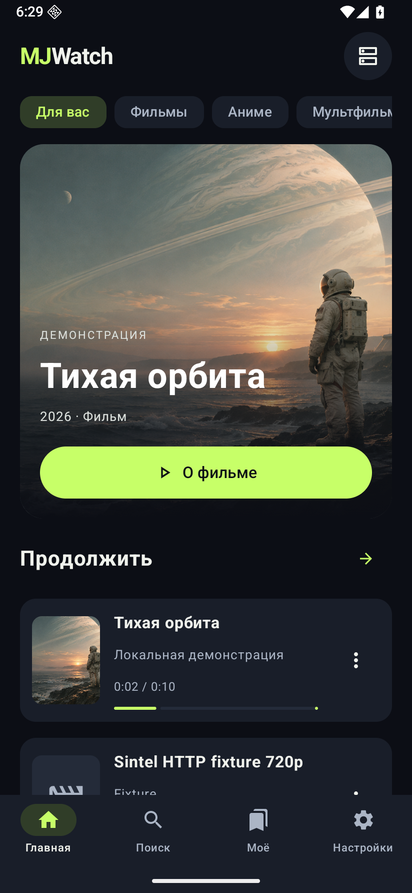
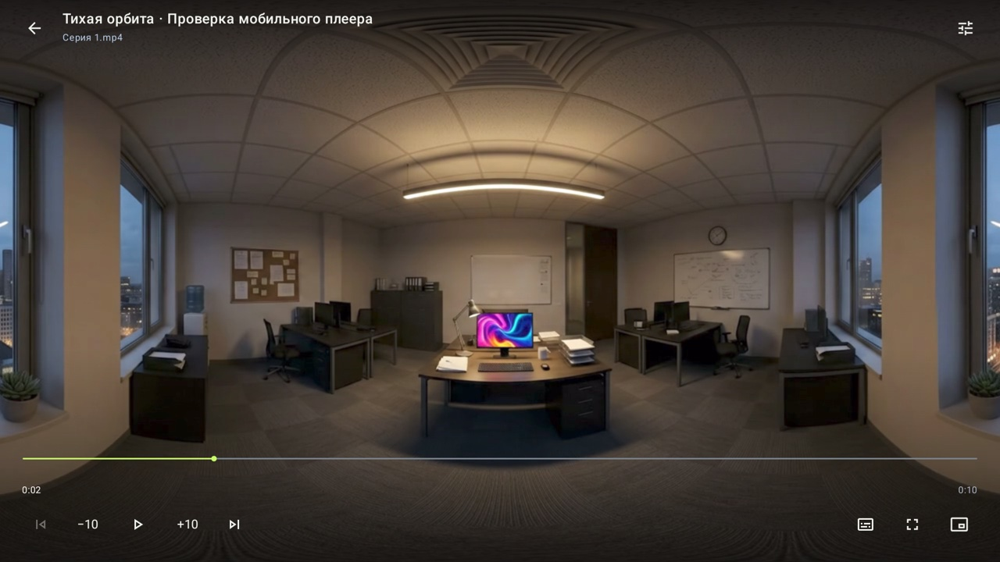
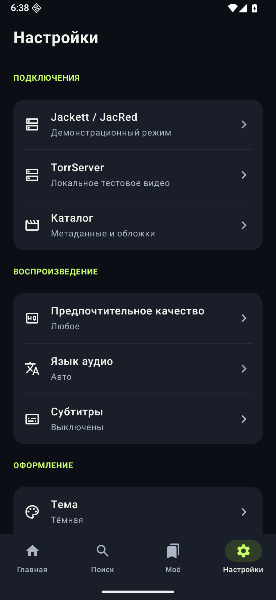

<p align="center"></p>

<p align="center">
  <a href="https://github.com/MJSasha/mj-watch/releases/latest"></a>
  
  <a href="https://github.com/MJSasha/mj-watch/actions/workflows/android.yml"></a>
</p>

<p align="center"><b>Найдите фильм. Выберите экран. Продолжите с того же места.</b><br>Фильмы и сериалы на телефоне, планшете и Android TV — в одном приложении.</p>


<table>
<tr><td width="33%" align="center"><b>Находите своё кино</b><br>Каталог TMDB, постеры и описания.<br>Поиск Jackett / JacRed и фильтры раздач.</td><td width="33%" align="center"><b>Смотрите на любом экране</b><br>Телефон, две панели планшета, TV с пультом.<br>Кнопка «Смотреть» предлагает экран, когда подключён TV.</td><td width="33%" align="center"><b>Возвращайтесь к просмотру</b><br>Избранное, сезоны и серии.<br>История и позиции между устройствами в managed.</td></tr>
</table>

## Ваше кино — всегда под рукой

<table>
<tr><td align="center" width="34%"></td><td width="66%"><br><b>Больше экран — больше пространства для кино.</b><br>Адаптивные экраны, тёмная и светлая темы, управление касанием или пультом.</td></tr>
</table>

## Плеер, в котором главное — видео



**MKV и MP4 · аудиодорожки и субтитры · двойной тап ±10 секунд · PiP · серии и автопереход.**
Контейнеры воспроизводит Media3; доступность конкретных кодеков зависит от Android-устройства.

<table>
<tr><td align="center"><b>Ваши подключения</b><br></td><td align="center"><b>Обновления внутри приложения</b><br></td></tr>
</table>

## Начните смотреть

1. [Скачайте последнюю версию](https://github.com/MJSasha/mj-watch/releases/latest): **MJWatch-mobile.apk** для телефона/планшета, **MJWatch-tv.apk** для телевизора.
2. Подключите **Jackett / JacRed + TorrServer** или войдите на свой **managed-сервер MJWatch**.
3. Найдите фильм и выберите раздачу. Проверить интерфейс можно в демонстрации с локальным видео.

**Офлайн на телефоне и планшете.** Выберите раздачу, нажмите **Скачать** и выберите файл фильма или отдельную серию. Загрузка сохраняется на этом устройстве и при подключённом TV. Перед поездкой откройте **Моё → Загрузки** и дождитесь готовности. Отсюда можно смотреть видео без сети или удалить его, чтобы освободить место на устройстве.

Managed добавляет аккаунты, приглашения, историю, синхронизацию и просмотр на подключённом TV. Для удалённого просмотра нужен managed-сервер и открытый MJWatch на телевизоре. Direct работает с готовым TorrServer без истории и удалённого подключения TV. [Подключение и сервер](server/README.md) · [Приглашения](docs/testing/INVITATION-LINKS.md) · [Телефон → TV](docs/testing/phone-tv/README.md).

Обновляйте APK **поверх установленного приложения**, чтобы сохранить данные. Встроенный updater проверяет размер, SHA-256, пакет и подпись; установку подтверждает Android. [Как выпускаются обновления](docs/UPDATES.md).

<sub>На изображениях — работающий интерфейс с демонстрационным каталогом и локальным видео. Приложение использует настроенные вами источники и не предоставляет фильмы.</sub>

<details>
<summary><b>Для разработчиков</b></summary>

Kotlin · Jetpack Compose · Media3 · Go / SQLite. JDK 21, Android SDK 36, Build Tools 36.0.0, Gradle 8.13. Укажите SDK в `local.properties` или `ANDROID_HOME`; подготовьте серверные assets по [инструкции сервера](server/README.md).

```sh
./gradlew :core:testDebugUnitTest :playback:testDebugUnitTest :app-mobile:lintDebug :app-tv:lintDebug
./gradlew :app-mobile:assembleDebug :app-tv:assembleDebug
```

[Состояние и ограничения](STATUS.md) · [Контракты](docs/contracts/README.md) · [Проверки](docs/testing/ACCEPTANCE-REPORT.md) · [Дизайн](design/README.md)

Программное декодирование аудио использует FFmpeg (LGPL 2.1 или новее) через расширение AndroidX Media3. Уведомления о лицензиях входят в APK. [Исходники и инструкции по пересборке и замене библиотеки](https://repo.maven.apache.org/maven2/io/put/media3-ffmpeg-decoder/1.11.1+1/media3-ffmpeg-decoder-1.11.1+1-ffmpeg-source.tar.xz) · [Репозиторий сборки и уведомления](https://github.com/putdotio/media3-ffmpeg-decoder/tree/v1.11.1%2B1).

Из семьи [MJAnime](https://github.com/MJSasha/mj-anime) и [MJReader](https://github.com/MJSasha/mj-reader). Ключи и пароли шифруются Android Keystore; внешней аналитики нет.

</details>
