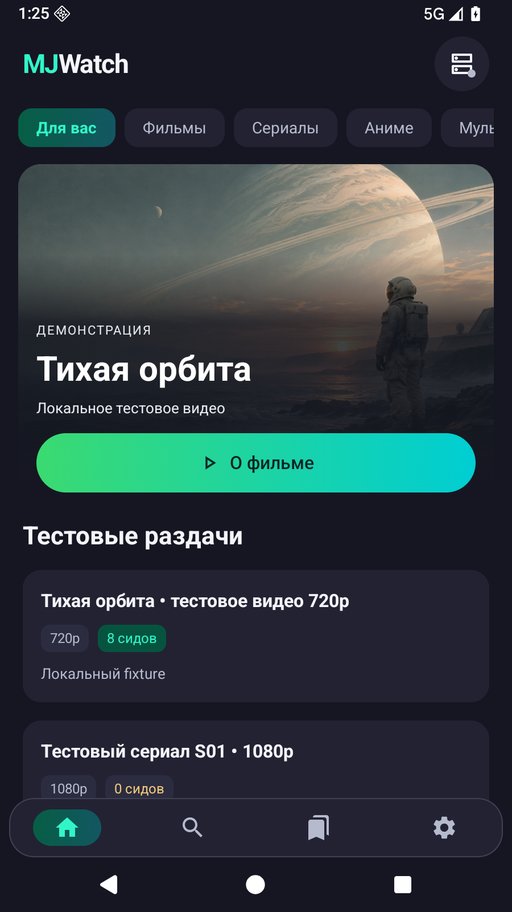
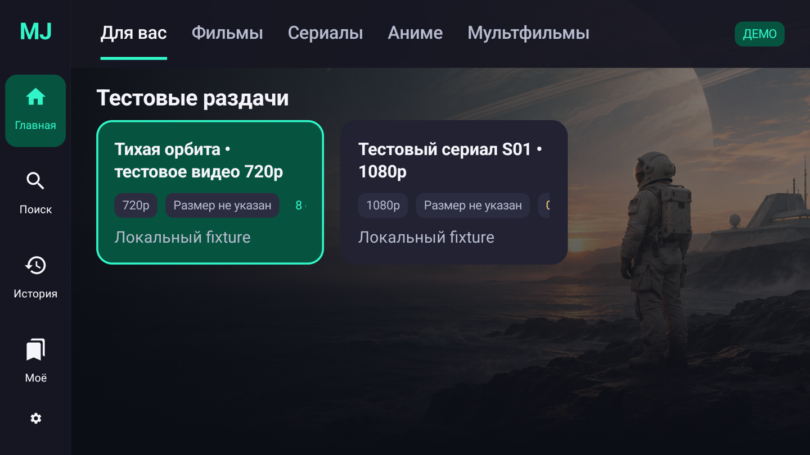

# MJWatch

<p align="center"></p>

<p align="center">
  <a href="https://github.com/MJSasha/mj-watch/releases/latest"></a>
</p>

<p align="center">
  
  <a href="https://github.com/MJSasha/mj-watch/actions/workflows/android.yml"></a>
</p>

<p align="center">
  <a href="#возможности">Возможности</a> · <a href="#как-выглядит">Скриншоты</a> · <a href="#установка-и-обновления">Установка</a> · <a href="design/README.md">Документация</a>
</p>

Фильмы и сериалы на телефоне, планшете и Android TV.

## Возможности

- Поиск через Jackett, JacRed или Prowlarr.
- Плеер Media3 с выбором дорожек и субтитров.
- История и синхронизация позиции в managed-режиме.

## Как выглядит

<table>
  <tr>
    <th width="50%" align="center">Главная на телефоне</th>
    <th width="50%" align="center">Главная на Android TV</th>
  </tr>
  <tr>
    <td align="center"><a href="docs/images/showcase-1.png"></a></td>
    <td align="center"><a href="docs/images/showcase-2.png"></a></td>
  </tr>
</table>

<sub>Снимки MJWatch 0.12.55 с демонстрационным каталогом и локальным видео.</sub>

## Установка и обновления

1. [Скачайте последнюю версию](https://github.com/MJSasha/mj-watch/releases/latest): **MJWatch-mobile.apk** для телефона/планшета, **MJWatch-tv.apk** для телевизора.
2. Подключите **Jackett / JacRed + TorrServer** или войдите на свой **managed-сервер MJWatch**.
3. Найдите фильм и выберите раздачу. Проверить интерфейс можно в демонстрации с локальным видео.

**Офлайн на телефоне и планшете.** Выберите раздачу, нажмите **Скачать** и выберите файл фильма или отдельную серию. Загрузка сохраняется на этом устройстве и при подключённом TV. Перед поездкой откройте **Моё → Загрузки** и дождитесь готовности. Отсюда можно смотреть видео без сети или удалить его, чтобы освободить место на устройстве.

Managed добавляет аккаунты, приглашения, историю, синхронизацию и просмотр на подключённом TV. Для удалённого просмотра нужен managed-сервер и открытый MJWatch на телевизоре. Direct работает с готовым TorrServer без истории и удалённого подключения TV. [Подключение и сервер](server/README.md) · [Приглашения](docs/testing/INVITATION-LINKS.md) · [Телефон → TV](docs/testing/phone-tv/README.md).

Обновляйте APK **поверх установленного приложения**, чтобы сохранить данные. Встроенный updater проверяет размер, SHA-256, пакет и подпись; установку подтверждает Android. [Как выпускаются обновления](docs/UPDATES.md).

<sub>На изображениях — работающий интерфейс с демонстрационным каталогом и локальным видео. Приложение использует настроенные вами источники и не предоставляет фильмы.</sub>

## Сборка

<details>
<summary><b>Для разработчиков</b></summary>

Kotlin · Jetpack Compose · Media3 · Go / SQLite. JDK 21, Android SDK 36, Build Tools 36.0.0, Gradle 8.13. Укажите SDK в `local.properties` или `ANDROID_HOME`; подготовьте серверные assets по [инструкции сервера](server/README.md).

```sh
./gradlew :core:testDebugUnitTest :playback:testDebugUnitTest :app-mobile:lintDebug :app-tv:lintDebug
./gradlew :app-mobile:assembleDebug :app-tv:assembleDebug
```

[Состояние и ограничения](STATUS.md) · [Контракты](docs/contracts/README.md) · [Проверки](docs/testing/ACCEPTANCE-REPORT.md) · [Дизайн](design/README.md)

Программное декодирование аудио использует FFmpeg (LGPL 2.1 или новее) через расширение AndroidX Media3. Уведомления о лицензиях входят в APK. [Исходники и инструкции по пересборке и замене библиотеки](https://repo.maven.apache.org/maven2/io/put/media3-ffmpeg-decoder/1.11.1+1/media3-ffmpeg-decoder-1.11.1+1-ffmpeg-source.tar.xz) · [Репозиторий сборки и уведомления](https://github.com/putdotio/media3-ffmpeg-decoder/tree/v1.11.1%2B1).

Ключи и пароли шифруются Android Keystore; внешней аналитики нет.

</details>

## Семейство MJ

[MJReader](https://github.com/MJSasha/mj-reader) · [MJAnime](https://github.com/MJSasha/mj-anime)
