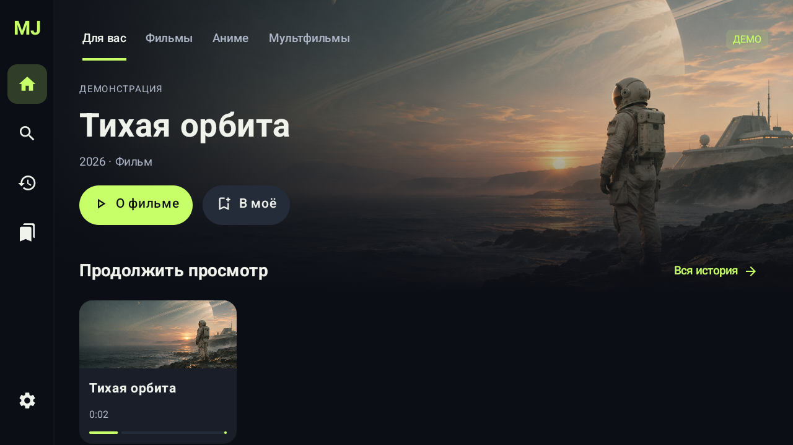
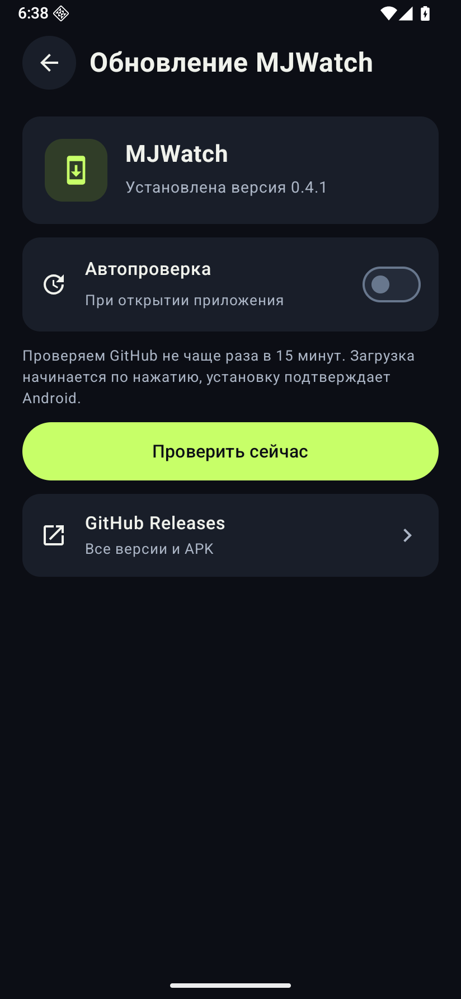
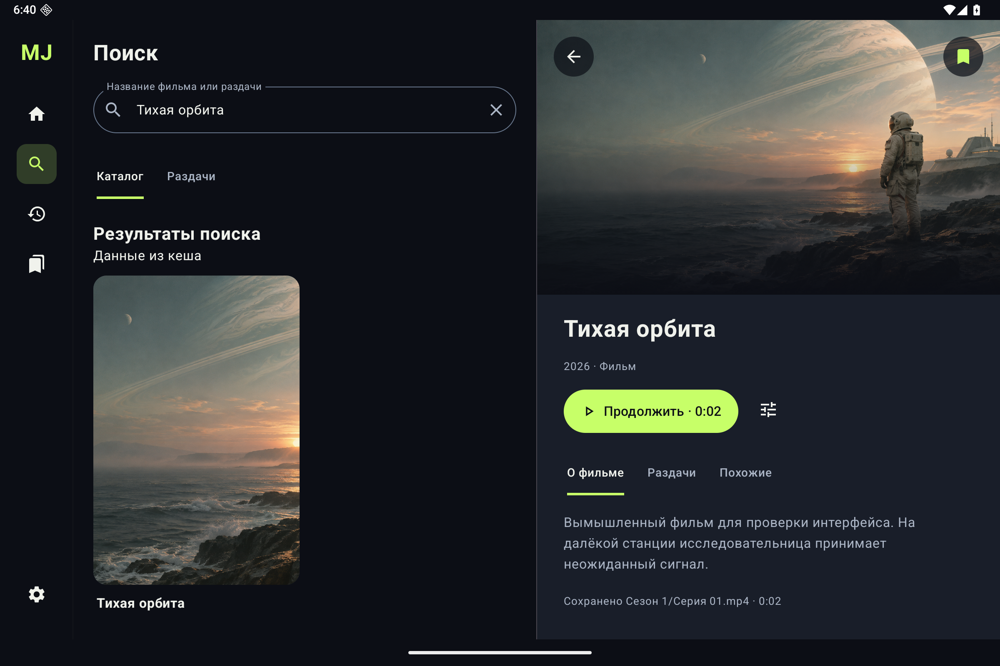
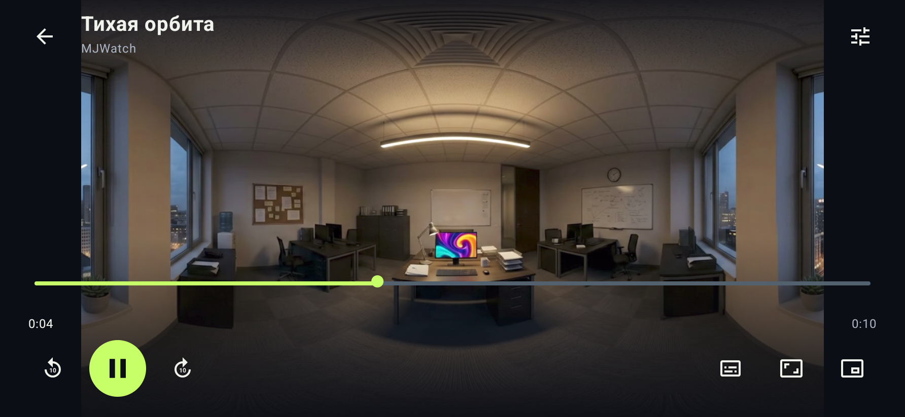

<p align="center"></p>

<p align="center">
  <a href="https://github.com/MJSasha/mj-watch/actions/workflows/android.yml"></a>
  <a href="https://github.com/MJSasha/mj-watch/releases"></a>
  
  
</p>

<p align="center">
  <a href="https://github.com/MJSasha/mj-watch/releases"><b>Скачать APK</b></a> ·
  <a href="#возможности">Возможности</a> ·
  <a href="#установка-и-обновления">Установка</a> ·
  <a href="#сборка">Сборка</a> ·
  <a href="docs/ui-audit/README.md">Проверки и дизайн</a>
</p>

**MJWatch** — нативное приложение для просмотра видео на Android-телефоне, планшете и TV.
Находит раздачи через Jackett или JacRed и получает поток от TorrServer. Managed синхронизирует место просмотра; direct работает без истории.
Оформление — из одной семьи с [MJAnime](https://github.com/MJSasha/mj-anime) и [MJReader](https://github.com/MJSasha/mj-reader).

*Native Android video client for phone, tablet and TV. Configurable Jackett/JacRed and TorrServer, optional TMDB metadata, Media3 playback. Kotlin and Jetpack Compose; two APKs with shared logic.*

## Как выглядит



<table>
<tr><td align="center"><b>Телефон</b></td><td align="center"><b>Настройки</b></td><td align="center"><b>Обновления</b></td></tr>
<tr><td></td><td></td><td></td></tr>
</table>

<details><summary><b>Планшет и плеер</b></summary>


</details>

Снимки работающего приложения на собственных эмуляторах. Каталог и постеры демонстрационные, видео локальное; это не подтверждение работы реальных серверов.

## Возможности

| Область | Что умеет |
| --- | --- |
| **Поиск** | Jackett / Torznab и JacRed JSON, фильтры качества, источника, сидов и языка |
| **Каталог** | Необязательный TMDB: обложки, описания и кеш; прямой поиск работает без него |
| **Просмотр** | TorrServer, выбор видеофайла, Media3, пауза, перемотка, дорожки и субтитры |
| **Библиотека** | Избранное; история, позиции и синхронизация в managed-режиме |
| **Устройства** | Телефон, две панели на планшете, отдельная TV-оболочка для D-pad/OK/Back |
| **Оформление** | Тёмная, светлая и системная темы, заметный фокус без увеличения карточек |
| **Обновления** | GitHub Releases, автоматическая и ручная проверка, проверенный APK и системная установка |

## Установка и обновления

1. Откройте [Releases](https://github.com/MJSasha/mj-watch/releases), выберите выпуск с отметкой **Latest**.
2. Выберите **MJWatch-mobile.apk** для телефона/планшета или **MJWatch-tv.apk** для телевизора.
3. Установите APK. Обновляйте **поверх установленного приложения**, чтобы сохранить подключения, историю и прогресс.

**Настройки → Обновления** — отдельная страница с установленной версией, состоянием проверки и действиями загрузки/установки. Автопроверка выполняется при открытии приложения не чаще раза в 15 минут; её можно отключить. Она не запускает загрузку сама. Установка требует подтверждения Android.

Перед установкой проверяются SHA-256, размер, имя пакета, возрастающая версия и совместимость подписи. Выпуски публикуются как **Latest** после проверок; используется прежняя подпись для обновления поверх установленных APK. [Процесс выпуска](docs/UPDATES.md).

## Подключения

- **Jackett / JacRed** — отдельная страница адреса, протокола, ключа и индексаторов. Для публичного `https://jac.red` обычно достаточно режима «Авто», без ключа и пароля; авторизация зависит от сервера.
- **TorrServer** — отдельная страница LAN URL, необязательной Basic Auth и проверки соединения. Для локального HTTP включите разрешение; при проблемах с `.local` используйте LAN IP.
- **Каталог** — отдельная настройка TMDB и Read Access Token. Без неё остаётся прямой поиск раздач.

Для проверки без серверов включите демонстрацию с локальным видео в первоначальной настройке. Каждый сервер проверяется отдельно; offline-сохранение разрешено. Reverse proxy prefix сохраняется, redirect запрещён — указывайте конечный URL.

Секреты шифруются Android Keystore. Экспорт не содержит ключей и паролей, импорт сначала показывает preview. Приложение не удаляет торренты на общем сервере и не содержит внешней аналитики.

## Управляемый сервер

Direct подключается к готовому TorrServer без истории. Managed устанавливает TorrServer и Go/SQLite-сервис через root SSH из приложения; добавляет аккаунты, синхронизацию и HTTPS-каталог. Версии сервера и APK независимы: подписанная поставка импортируется из приложения с backup и проверкой отката.

Пригласить человека: **Пользователи → Добавить пользователя → Поделиться ссылкой**. Получатель нажимает ссылку, MJWatch открывает регистрацию с вводом нового пароля. При отсутствии приложения страница предлагает APK и сохраняет приглашение для открытия после установки. Для прямых ссылок обновите APK до 0.8.0 и managed-сервер до 0.1.2; данные аккаунтов и подписи сохраняются. [Сценарий и проверки](docs/testing/INVITATION-LINKS.md).

Обновить сервер: **Настройки → Мой сервер → Обслуживание → Обновить сервер**. Мастер объясняет SSH-доступ и парольную фразу копии, показывает выбранную версию, ход операции и подтверждённый результат. После прерывания сначала проверяется прежняя операция. [Сценарий обновления](docs/testing/SERVER-UPDATE-FLOW.md).

[Сборка и эксплуатация](server/README.md), [контракты](docs/contracts/MANAGED-V1.md), [проверки и ограничения](docs/testing/SERVER-MANAGEMENT-V1.md). Перед сборкой Android подготовьте подписанные серверные assets по инструкции сервера.

## Сборка

JDK **21**, Android SDK **36**, Build Tools **36.0.0**, Gradle wrapper **8.13**. Укажите `sdk.dir` в локальном `local.properties` либо `ANDROID_HOME`.

```sh
./gradlew :core:testDebugUnitTest :app-mobile:lintDebug :app-tv:lintDebug
./gradlew :app-mobile:assembleDebug :app-tv:assembleDebug
./gradlew :app-mobile:assembleRelease :app-tv:assembleRelease
```

Debug APK находятся в `app-mobile/build/outputs/apk/debug/` и `app-tv/build/outputs/apk/debug/`. Локальные release APK unsigned. Подписанные APK с отметкой **Latest** публикуются из `main` после зелёных unit/lint/build и Android runtime checks. Разные пакеты `dev.mjwatch.mobile` / `dev.mjwatch.tv` устанавливаются одновременно и не заменяют MJAnime.

## Документация

- [Текущее состояние и ограничения](STATUS.md), [проверки](docs/testing/ACCEPTANCE-REPORT.md)
- [Дизайн и сценарии](design/README.md), [стандарт MJ Family](docs/mj-family/guide.html), [галерея сверки](docs/ui-audit/index.html)
- [Интеграционные контракты](docs/contracts/README.md), [публикация и обновления](docs/UPDATES.md)

Ключи подписи, токены, APK и кеши не хранятся в Git.
