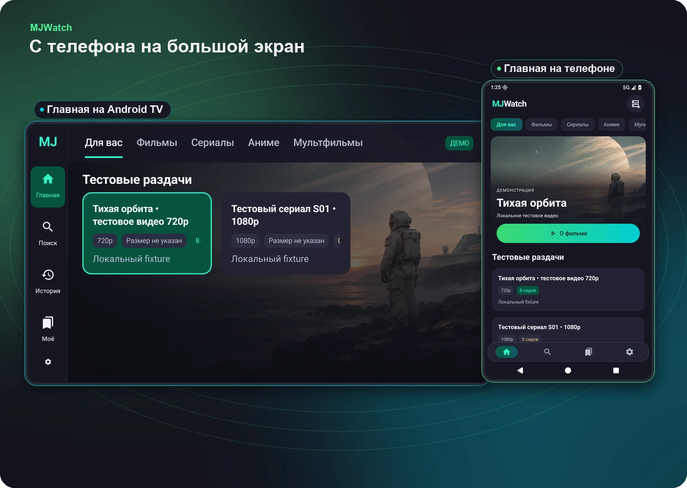

  

Фильмы и сериалы на телефоне, планшете и Android TV. В управляемом режиме можно продолжить просмотр на другом устройстве.

<a href="docs/images/showcase-1.png">Главная на телефоне</a> · <a href="docs/images/showcase-2.png">Главная на Android TV</a>

<a href="https://github.com/MJSasha/mj-watch/wiki"><b>Wiki</b></a> · <a href="https://github.com/MJSasha/mj-reader">MJReader</a> · <a href="https://github.com/MJSasha/mj-anime">MJAnime</a>

