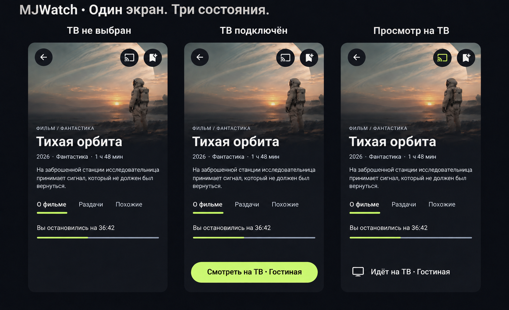

# MJWatch: просмотр на ТВ с телефона

17.11.2026 · Дизайн-проект v1, редакция 2 · Статус: проектирование, не реализованная функция.

Пользователь выбирает видео на телефоне и запускает его на конкретном подключённом ТВ. Видео воспроизводится на ТВ; телефон остаётся каталогом и средством выбора устройства. Плей, пауза, перемотка и громкость доступны через системные средства Android. Нового пульта, мини-плеера с транспортом и собственного ползунка громкости в приложении нет.

## Зафиксированные решения

1. **Единый раздел «Устройства».** Телефон, планшет и ТВ имеют одинаковую структуру строки; тип различается иконкой. Не создавать пункт, вкладку или страницу верхнего уровня «Телевизоры».
2. **Запуск требует установленного соединения с ТВ.** Запись устройства в аккаунте, совпадение Wi-Fi и факт обнаружения не равны подключению. Нужны полномочия, доступность и успешное установление сессии.
3. **Несколько ТВ.** Сохраняются все устройства; у телефона только один активный адресат запуска и управления. Разные ТВ могут независимо воспроизводить разные видео. Синхронное воспроизведение на группе ТВ в v1 не входит.
4. **Переименовывать может сам пользователь.** Общая команда в меню любой своей строки, включая телефон и планшет; административная роль не нужна.
5. **Внешний вид системных controls определяет Android.** В макетах приложения системную панель не рисуем и не обещаем фирменную карточку. Приложение передаёт метаданные, состояние и разрешённые действия.
6. **Закладка независима от ТВ.** Кнопка справа сверху сохраняется во всех состояниях карточки, включая отсутствие подключения. Выбор ТВ не занимает её место.

## Макеты

Это три листа одного решения, всего восемь кадров. Отдельные экраны добавления и переименования удалены; существующее сканирование не меняется. Использованы существующие экран, палитра, типографика и киноиллюстрация MJWatch. Тексты и правила ниже приоритетнее иллюстративных деталей растра. Полоска «Вы остановились на 36:42» — статичная информация о сохранённой позиции, без жеста перемотки и без роли slider.

| Кадр | Назначение | Переход / результат |
|---|---|---|
| M01 ТВ не выбран | Карточка фильма без кнопки запуска или подключения внизу | Иконка трансляции в шапке открывает M07; закладка работает независимо |
| M02 ТВ подключён | Одна кнопка «Смотреть на ТВ · Гостиная» | Запуск на выбранном ТВ, при необходимости через выбор релиза/файла; без повторного выбора устройства |
| M03 Просмотр на ТВ | Только статус «Идёт на ТВ · Гостиная» внизу | Иконка трансляции позволяет сменить адресат; собственного транспорта нет |
| M04 Общий список | Телефоны, планшеты, ТВ, тип по иконке; меню ⋮ у строки | «Переименовать» открывает M06 поверх списка, без нового маршрута |
| M06 Переименование | Небольшой модальный диалог поверх M04: имя, «Отмена», «Сохранить» | Сохранить имя либо закрыть диалог; список и прокрутка сохраняются |
| M07 Где смотреть? | Компактный sheet только с подходящими ТВ; вызов иконкой трансляции | Выбрать адресат без запуска; «Все устройства» открывает общий список |
| M08 ТВ уже занят | Короткий диалог «Заменить видео?» с именем ТВ и видео | Явно подтвердить замену или отменить, без нового экрана |
| M09 Потеря связи | Встроенное сообщение на карточке и действие «Повторить» | Восстановить соединение либо выбрать другой ТВ иконкой трансляции; кнопки запуска нет |

Номер M05 сохранён как удалённый: новый экран добавления из предыдущей редакции исключён. Не реализовывать его и не менять существующее сканирование QR/кода.

## Размещение и минимальная навигация

Вход в общий список остаётся через существующие настройки аккаунта / устройства. В direct-режиме тот же общий реестр относится к настройкам подключений. Новых вкладок, TV-only раздела, страницы добавления или страницы переименования нет.

В шапке карточки слева «Назад», справа две отдельные icon buttons: **трансляция**, затем **закладка** у правого края. У каждой цель ≥48dp, промежуток ≥8dp и своё доступное имя. Трансляция открывает «Где смотреть?»; закладка только добавляет/удаляет фильм из «Моего». Не заменять одну другой. Иконка трансляции доступна до подключения; её доступное описание включает выбранный ТВ/состояние, при просмотре она выделена. Дополнительной строки «ТВ: …» нет.

Внизу карточки только одно состояние:

- ТВ не подключён — нет кнопки запуска, нет кнопки «Подключить ТВ» и нет дублирующего призыва подключиться. Выбор выполняется иконкой трансляции в шапке.
- ТВ подключён — одна кнопка **«Смотреть на ТВ · Гостиная»**. Имя длинного устройства сокращается визуально, полное доступно в TalkBack и выборе ТВ; при крупном шрифте разрешён перенос без обрезания.
- Видео уже идёт — спокойный статус **«Идёт на ТВ · Гостиная»** вместо дублирующего запуска и инструкции про уведомления. Play/pause/seek/volume остаются системными.
- Соединение потеряно — короткое сообщение на месте «Нет связи с ТВ …», пояснение, что видео могло продолжиться, и «Повторить». Отдельный экран ошибки не открывается.

Выбор в sheet только подключает/меняет адресат и закрывает sheet. Он не запускает видео. Back/свайп сохраняет прежний выбор и возвращает фокус к иконке трансляции. «Смотреть на ТВ» не открывает выбор повторно; при потере подключения запуск блокируется и показывается M09. Если список пуст, sheet кратко сообщает об отсутствии доступных ТВ и оставляет «Все устройства»; новый мастер добавления из него не создаётся.

Существующие сканер, ввод кода, их точки входа, разрешения камеры и pairing-flow сохраняются **как есть**. В этом проекте не рисовать и не реализовывать замену сканирования. Для устройств, которым потребуется иная техническая привязка, сначала подтвердить её в spike; не расширять интерфейс сканера без отдельной задачи.

Главная / Поиск / Моё / Настройки сохраняются. В поиске, истории, списках серий, файлов, раздач и deep links нельзя обойти проверку подключения. Без активного ТВ каталог, описание и избранное доступны, прямые действия запуска скрыты; не подменять их кнопкой подключения. Переход в источники допустим для ознакомления, но финальный запуск закрыт до соединения. При потере связи уже открытые CTA исчезают с контекстным пояснением.

Правило относится к телефону и планшету как контроллерам. Самостоятельный просмотр и физический пульт на ТВ сохраняются; ТВ не подключается к самому себе. Демо с локальным видео остаётся инструментом проверки в настройках.

## Состояния соединения и запуска

`Не добавлен → Обнаружен → Привязан → Подключается → Подключён → Нет связи / Отозван`.

«Привязан» означает сохранённое разрешение на устройство; «Доступен» — обнаружен и отвечает; «Подключён» — выбран и готов принять команду. После перезапуска можно помнить последний выбор, но разблокировать запуск только после повторной проверки. Даже один доступный ТВ выбирается явно при первом подключении.

`Подключён → Отправляем видео → Готовим на ТВ → Воспроизводится / Пауза / Ошибка`.

После нажатия запуска показывать реальную стадию, защищать от повторного нажатия; не считать отправку команды первым кадром. Ошибка сохраняет фильм, релиз, файл и выбранное устройство. Пока готовится поток, каталог остаётся доступен. ТВ получает идентификатор контента/сессии, а не секреты настроек телефона.

## Несколько телевизоров и несколько телефонов

- В контекстном выборе — только принадлежащие пользователю / разрешённые ему ТВ с capability удалённого видео. Список устройств при этом общий. Неподключённый приёмник сначала проходит подключение; старт не отправляется в неизвестный адресат.
- Имя адресата видно до запуска и в состоянии просмотра. При одинаковых именах показать модель / короткий ID. Offline ТВ виден, но недоступен для выбора; рядом текстовая причина.
- Выбор другого ТВ меняет адресат следующих действий, сам по себе не запускает и не переносит видео. Текущее воспроизведение на прежнем ТВ продолжается. На новой цели нужен отдельный запуск; автоматический перенос прогресса в v1 не обещается.
- Если на выбранном ТВ уже идёт другое видео, запросить подтверждение M08. Проверять занятую сессию повторно на приёмнике перед заменой, чтобы не остановить новое видео из-за устаревшего диалога.
- Если там уже идёт тот же файл, присоединиться к текущему управлению без перезапуска и сброса позиции.
- Изменения с физического пульта или другого авторизованного телефона обновляют состояние системных controls. На каждом ТВ одна актуальная сессия; на телефоне один текущий адресат управления. Команда всегда содержит однозначную цель/сессию.
- Отключить контроллер и остановить воспроизведение — разные действия. Отключение телефона, закрытие приложения или потеря Wi-Fi не останавливают ТВ автоматически. Остановку выполнять системным действием при наличии поддержки.

## Подключение и переименование

Существующую привязку и сканирование не переделывать. Локальное обнаружение предлагает кандидатов, но не даёт разрешение управлять автоматически; требования совместимости и доверия проверяются в техническом spike.

Переименование: **Устройства → ⋮ нужной строки → «Переименовать» → модальный диалог**. Диалог содержит заголовок «Переименовать устройство», одно поле «Название», счётчик и текстовые действия «Отмена» / «Сохранить». Отдельного экрана, полноэкранного sheet, информационного абзаца и большой CTA нет. Ошибка отображается у поля и не стирает ввод. Back/нажатие снаружи отменяет несохранённое изменение, возвращая к той же строке. Во время сохранения повторный submit заблокирован; результат подтверждается после записи.

Имя — пользовательский alias стабильного device ID, 1–32 Unicode-символа после удаления краевых пробелов. Пустое имя, управляющие символы и превышение лимита не сохраняются. Дубликаты допустимы с различением по ID. Alias пользователя не переименовывает системный Cast receiver глобально для всех жильцов; на системных поверхностях имя маршрута может отличаться. Это объясняется в сведениях устройства.

Сохранять alias на сервере в аккаунтном режиме; в direct — локально для пары. Запретить редактирование чужих устройств на API. Offline-сохранение в managed не объявлять успешным серверным: показать «Ожидает синхронизации» или честную ошибку. Переименование активного ТВ не разрывает сессию; смена alias отражается в интерфейсе приложения. Отзыв устройства сбрасывает доступ и закрывает запуск.

## Адаптация и доступность

Палитра и компоненты — [DESIGN-SYSTEM.md](../spec/DESIGN-SYSTEM.md). Phone: 412×892 reference; реальные insets, прокрутка и IME. Tablet: тот же общий список слева и сведения справа при достаточной ширине; не плодить навигацию. TV: существующий D-pad, в сведениях своё имя/права подключения, видимый фокус, Back закрывает диалог с возвратом фокуса.

Цели касания ≥48dp; тип и состояние устройства имеют семантические labels и текст, цвет не единственный сигнал. Меню строки — отдельная цель. При 200% fontScale имена переносятся, действия не обрезаются, поле и CTA доступны над IME. TalkBack читает «Гостиная, телевизор, подключён для просмотра». Системные controls не перерисовываются приложением.

## Передача в реализацию

Сначала выполнить проверку платформенного пути из [SYSTEM-MEDIA.md](SYSTEM-MEDIA.md), затем общий реестр устройств и aliases, проверку подключения на всех входах запуска, адресный запуск на ТВ, системную медиасессию и сценарии восстановления. Проверять по [ACCEPTANCE.md](ACCEPTANCE.md). Код приложения и контракт сервера в этой поставке не изменены.
