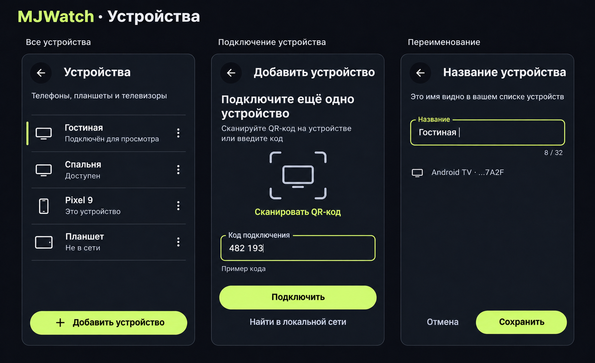
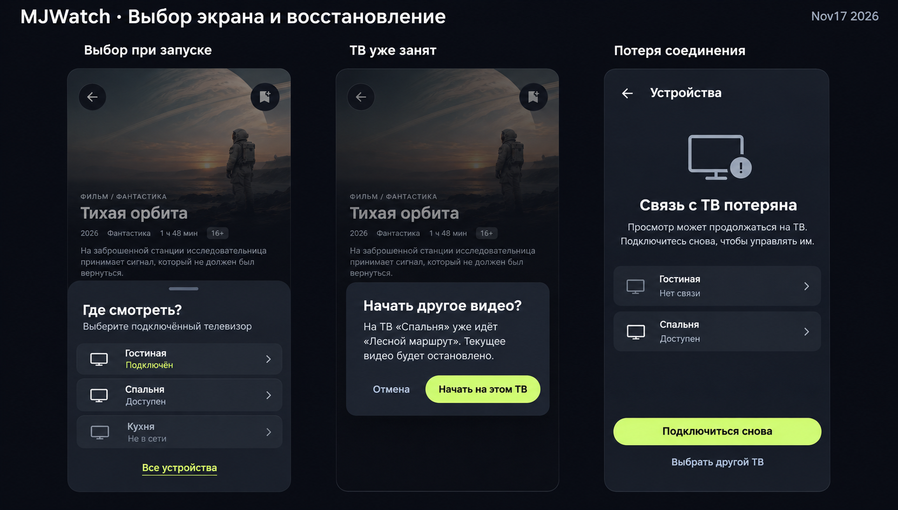

# MJWatch: просмотр на ТВ с телефона

17.11.2026 · Дизайн-проект v1 · Статус: проектирование, не реализованная функция.

Пользователь выбирает видео на телефоне и запускает его на конкретном подключённом ТВ. Видео воспроизводится на ТВ; телефон остаётся каталогом и средством выбора устройства. Плей, пауза, перемотка и громкость доступны через системные средства Android. Нового пульта, мини-плеера с транспортом и собственного ползунка громкости в приложении нет.

## Зафиксированные решения

1. **Единый раздел «Устройства».** Телефон, планшет и ТВ имеют одинаковую структуру строки; тип различается иконкой. Не создавать пункт, вкладку или страницу верхнего уровня «Телевизоры».
2. **Запуск требует установленного соединения с ТВ.** Запись устройства в аккаунте, совпадение Wi-Fi и факт обнаружения не равны подключению. Нужны полномочия, доступность и успешное установление сессии.
3. **Несколько ТВ.** Сохраняются все устройства; у телефона только один активный адресат запуска и управления. Разные ТВ могут независимо воспроизводить разные видео. Синхронное воспроизведение на группе ТВ в v1 не входит.
4. **Переименовывать может сам пользователь.** Общая команда в меню любой своей строки, включая телефон и планшет; административная роль не нужна.
5. **Внешний вид системных controls определяет Android.** В макетах приложения системную панель не рисуем и не обещаем фирменную карточку. Приложение передаёт метаданные, состояние и разрешённые действия.

## Макеты

Это три листа одного решения, всего девять кадров. Использованы существующие экран, палитра, типографика и киноиллюстрация MJWatch. Тексты и правила ниже приоритетнее иллюстративных деталей растра. Полоска «Ваш просмотр» — статичная информация о сохранённой позиции, без жеста перемотки и без роли slider.

| Кадр | Назначение | Переход / результат |
|---|---|---|
| M01 Нет подключения | Карточка фильма, описание, сохранённая позиция; вместо запуска «Подключить ТВ» | Открыть контекстный выбор доступного ТВ либо общий список устройств для добавления |
| M02 ТВ подключён | Имя активного ТВ у карточки; «Смотреть на ТВ» | Выбор релиза/файла при необходимости → проверка адресата → запуск на нём |
| M03 Уже идёт на ТВ | Название, текущий ТВ, пояснение об управлении через Android | Никаких дублирующих play/pause/seek/volume; можно выбрать другой ТВ |
| M04 Все устройства | Общий список, иконки типов, статус, меню каждой строки | ТВ → подключение/сведения; телефон и планшет → сведения, без назначения приёмником |
| M05 Добавить устройство | Общий существующий сценарий QR/код с другого устройства, поиск локальных ТВ | Проверка → подтверждённая привязка → общий список; добавление не запускает видео |
| M06 Название устройства | Имя, счётчик, тип и короткий ID | Сохранить / отмена, ошибка не стирает ввод |
| M07 Где смотреть? | Контекстный sheet только с подходящими ТВ | Выбрать адресата; «Все устройства» ведёт в общий список. Это не отдельный раздел ТВ |
| M08 ТВ уже занят | Названия ТВ и текущего видео; предупреждение о замене | Явное подтверждение запуска другого видео; отмена сохраняет текущее |
| M09 Потеря соединения | Сведения о потерянной связи, повтор, другой адресат | Вернуть актуальное состояние с ТВ; не утверждать, что просмотр остановлен |

В M09 показана контекстная помощь для выбранного ТВ и альтернативных ТВ, а не полный новый список устройств. Основной список остаётся M04, с телефонами и планшетами.

## Размещение в существующем приложении

Вход через существующие настройки аккаунта / список устройств. Если устройство работает в direct-режиме, тот же общий список доступен из настроек подключений, без обязательного создания аккаунта. Не добавлять нижнюю вкладку или TV-only раздел. Вход в контекстный выбор экрана — из индикатора назначения на карточке/в шапке каталога и действия подключения.

Главная / Поиск / Моё / Настройки сохраняются. В поиске, истории, продолжении просмотра, списках серий, файлов и раздач нельзя обойти проверку подключения. Без активного ТВ каталог, описание, поиск и избранное доступны; кнопки «Смотреть», «Продолжить», play-иконки и прямые действия запуска скрыты. На их месте одно понятное действие подключения. Переход в источники допустим для ознакомления, но финальный запуск также закрыт до соединения. При потере связи уже открытые CTA немедленно становятся недоступны с пояснением.

Правило относится к телефону и планшету в роли контроллера. Нативный самостоятельный просмотр и физический пульт на ТВ сохраняются; ТВ не должен подключаться к самому себе. Демо с локальным видео остаётся инструментом проверки в настройках и не выдаётся за удалённый просмотр.

## Состояния соединения и запуска

`Не добавлен → Обнаружен → Привязан → Подключается → Подключён → Нет связи / Отозван`.

«Привязан» означает сохранённое разрешение на устройство; «Доступен» — обнаружен и отвечает; «Подключён» — выбран и готов принять команду. После перезапуска можно помнить последний выбор, но разблокировать запуск только после повторной проверки. Даже один доступный ТВ выбирается явно при первом подключении.

`Подключён → Отправляем видео → Готовим на ТВ → Воспроизводится / Пауза / Ошибка`.

После нажатия запуска показывать реальную стадию, защищать от повторного нажатия; не считать отправку команды первым кадром. Ошибка сохраняет фильм, релиз, файл и выбранное устройство. Пока готовится поток, каталог остаётся доступен. ТВ получает идентификатор контента/сессии, а не секреты настроек телефона.

## Несколько телевизоров и несколько телефонов

- В контекстном выборе — только принадлежащие пользователю / разрешённые ему ТВ с capability удалённого видео. Список устройств при этом общий. Неподключённый приёмник сначала проходит подключение; старт не отправляется в неизвестный адресат.
- Имя адресата видно до запуска и в состоянии просмотра. При одинаковых именах показать модель / короткий ID. Offline ТВ виден, но недоступен для выбора; рядом текстовая причина.
- Выбор другого ТВ меняет адресат следующих действий, сам по себе не запускает и не переносит видео. Текущее воспроизведение на прежнем ТВ продолжается. На новой цели нужен отдельный запуск; автоматический перенос прогресса в v1 не обещается.
- Если на выбранном ТВ уже идёт другое видео, запросить подтверждение M08. Проверять занятую сессию повторно на приёмнике перед заменой, чтобы не остановить новое видео из-за устаревшего диалога.
- Если там уже идёт тот же файл, присоединиться к текущему управлению без перезапуска и сброса позиции.
- Изменения с физического пульта или другого авторизованного телефона обновляют состояние системных controls. На каждом ТВ одна актуальная сессия; на телефоне один текущий адресат управления. Команда всегда содержит однозначную цель/сессию.
- Отключить контроллер и остановить воспроизведение — разные действия. Отключение телефона, закрытие приложения или потеря Wi-Fi не останавливают ТВ автоматически. Остановку выполнять системным действием при наличии поддержки.

## Подключение и переименование

Переиспользовать текущий QR/код для привязки аккаунта, не создавать параллельный логин ТВ. Локальное обнаружение предлагает кандидатов, но не даёт право управления само по себе. В direct-режиме доверие подтверждается на ТВ через одноразовый код/QR; это проектируемое расширение, существующий managed pairing его автоматически не обеспечивает. Отказ камеры оставляет ввод кода; истёкший код — получить новый на устройстве. Нет сети / изоляция Wi-Fi / нет совместимого ТВ имеют свои сообщения и повтор поиска.

Имя — пользовательский alias стабильного device ID, 1–32 Unicode-символа после удаления краевых пробелов. Пустое имя, управляющие символы и превышение лимита не сохраняются. Дубликаты допустимы с различением по ID. Alias пользователя не переименовывает системный Cast receiver глобально для всех жильцов; на системных поверхностях имя маршрута может отличаться. Это объясняется в сведениях устройства.

Сохранять alias на сервере в аккаунтном режиме; в direct — локально для пары. Запретить редактирование чужих устройств на API. Offline-сохранение в managed не объявлять успешным серверным: показать «Ожидает синхронизации» или честную ошибку. Переименование активного ТВ не разрывает сессию; смена alias отражается в интерфейсе приложения. Отзыв устройства сбрасывает доступ и закрывает запуск.

## Адаптация и доступность

Палитра и компоненты — [DESIGN-SYSTEM.md](../spec/DESIGN-SYSTEM.md). Phone: 412×892 reference; реальные insets, прокрутка и IME. Tablet: тот же общий список слева и сведения справа при достаточной ширине; не плодить навигацию. TV: существующий D-pad, в сведениях своё имя/права подключения, видимый фокус, Back закрывает диалог с возвратом фокуса.

Цели касания ≥48dp; тип и состояние устройства имеют семантические labels и текст, цвет не единственный сигнал. Меню строки — отдельная цель. При 200% fontScale имена переносятся, действия не обрезаются, поле и CTA доступны над IME. TalkBack читает «Гостиная, телевизор, подключён для просмотра». Системные controls не перерисовываются приложением.

## Передача в реализацию

Сначала выполнить проверку платформенного пути из [SYSTEM-MEDIA.md](SYSTEM-MEDIA.md), затем общий реестр устройств и aliases, проверку подключения на всех входах запуска, адресный запуск на ТВ, системную медиасессию и сценарии восстановления. Проверять по [ACCEPTANCE.md](ACCEPTANCE.md). Код приложения и контракт сервера в этой поставке не изменены.
