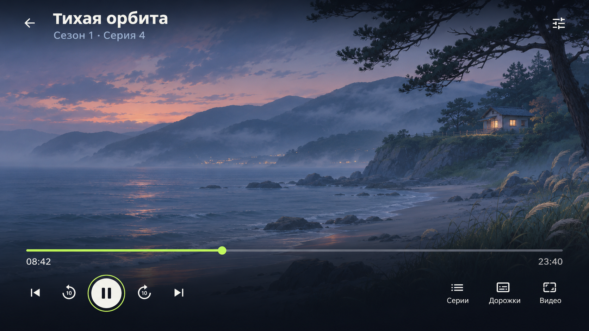
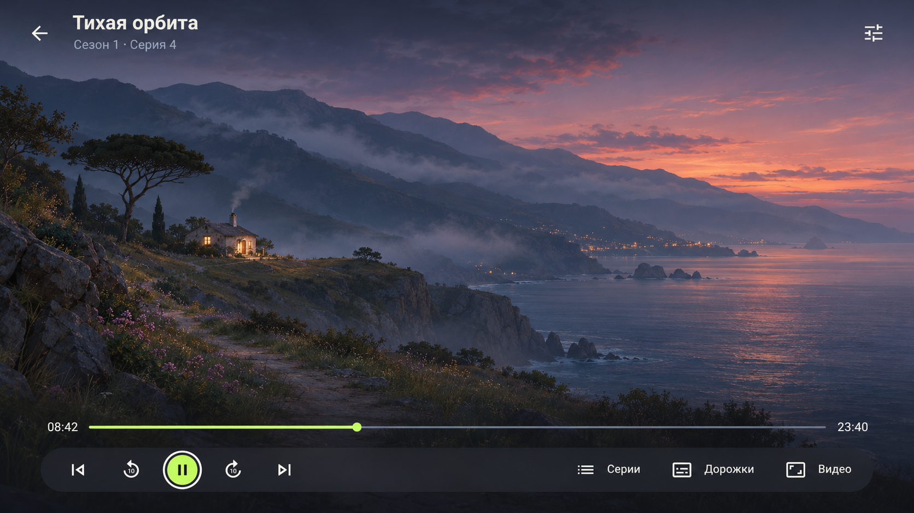
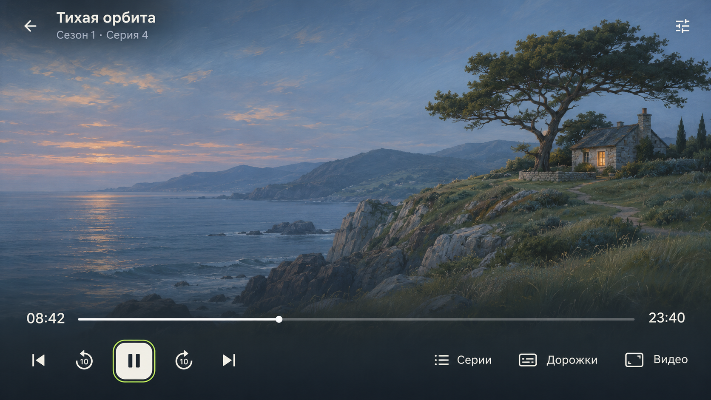
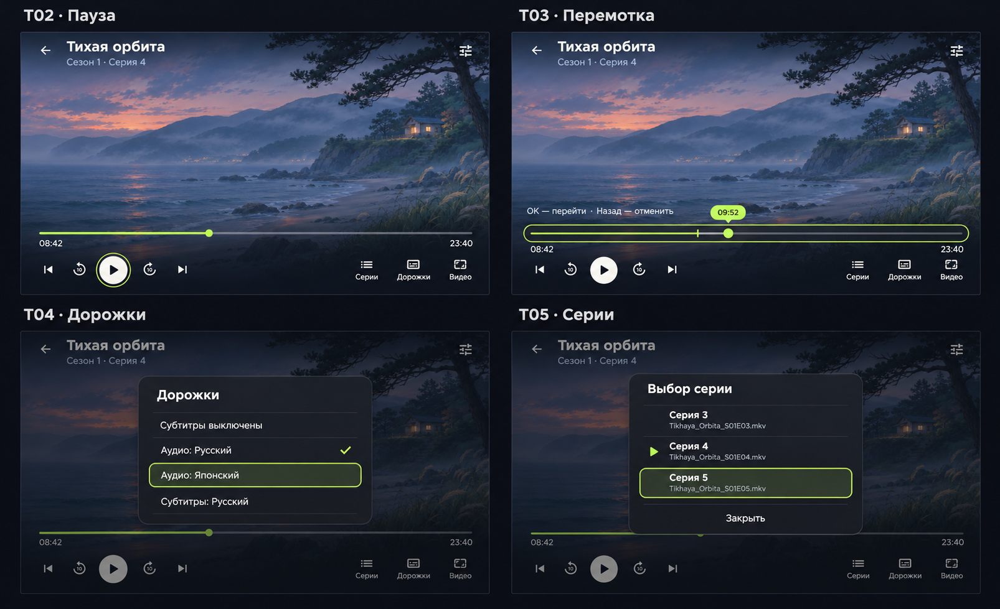
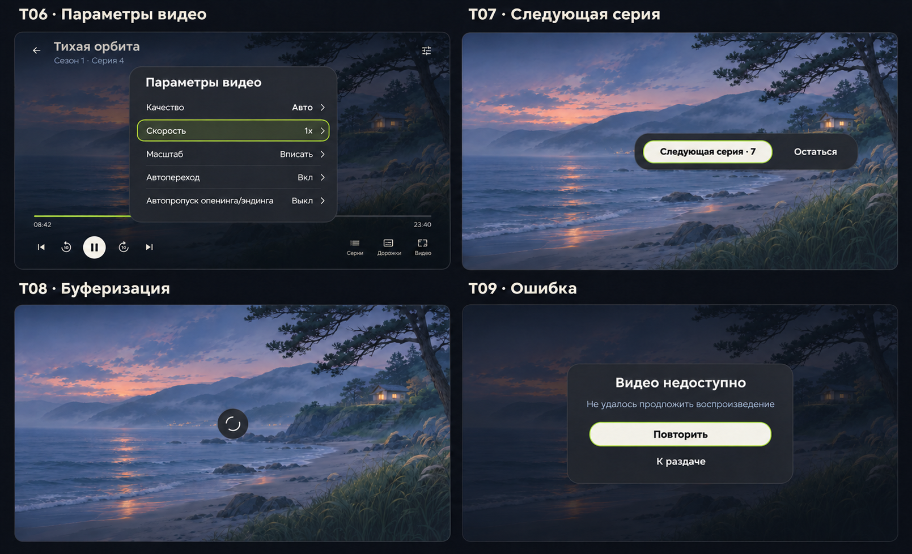

> **Актуальная проработка: [Редакция 3 — минималистичный плеер](revision-3/README.md).** Градиент сохраняется; пользователь просит меньше визуального шума. Убраны dock, постоянные подложки, разделители и одновременные подписи. Три новых варианта пока на выбор. [Редакция 2](revision-2/README.md) и материалы ниже — история визуального поиска; поведенческий контракт REMOTE.md сохраняется. Старые transport controls не являются актуальным визуальным заданием.

# MJWatch · Soft Cinema
17 ноября 2026 · Дизайн-проект плеера v1 · Предложение для обсуждения, без реализации.

## Задача и границы
Современный, мягкий, минималистичный экран просмотра на Android TV с сохранением существующего поведения физического пульта, медиакнопок и системного управления. Главным остаётся видео; интерфейс занимает только безопасные края кадра.

Актуальный продуктовый контракт телефона — каталог и системное управление ТВ ([проект #26](https://github.com/MJSasha/mj-watch/issues/26)). Собственный мобильный пульт, локальный мобильный плеер и редизайн системной карточки Android в эту поставку не входят. Дизайн не меняет Media3, сетевое восстановление, историю, настройки или формат видео. Связанные #24 и #25 не считаются исправленными этими макетами.

## Визуальное решение
Рекомендуемое направление — **Soft Cinema**: мягкое локальное затемнение вместо тяжёлых панелей, спокойная светлая кнопка воспроизведения, тонкая шкала и лайм только как небольшой акцент прогресса/фокуса. Нет свечения, изменения масштаба кнопок и стеклянных рамок вокруг всего плеера.

Три самостоятельных направления опубликованы для сравнения; рекомендация не означает согласование пользователем.
- **Soft Cinema** — открытая композиция на видео; основная спецификация ниже.
- **Quiet Dock** — более явная компактная нижняя подложка для группировки.
- **Editorial Fade** — нейтральная шкала и более заметное время.

### Основной экран T01 · Просмотр с управлением

### Альтернативы

### Состояния основного направления

В альбоме 11 кадров: три направления основного экрана и восемь дополнительных состояний Soft Cinema. Это растровые визуальные макеты, не скриншоты работающей новой версии и не редактируемый Figma-файл. Иллюстрация — пример видеокадра, не новый фон приложения. Подписи над кадрами альбома не входят в интерфейс.

## Композиция и размеры
Номинальная сетка полного экрана — **1920×1080**, 16:9. Реальные размеры PNG и происхождение указаны в [ASSETS.md](ASSETS.md); не растягивать исходники до номинального разрешения. Размеры ниже — reference pixels, не dp. Для 1280×720 коэффициент 2/3; реальные dp/sp определяются density и размером окна Android TV. На телевизоре проверить читаемость с дивана.

| Элемент | Сетка 1920×1080 |
|---|---|
| Безопасные поля | 72 px слева/справа, минимум 54 px сверху/снизу |
| Верхняя строка | Назад слева, затем заголовок/серия; справа прежний вход «Дорожки» |
| Заголовок | Roboto Medium, 36/44 px; вторичная строка 24/32 |
| Шкала | Примерно y=855; трек 4–6 px, thumb 16–20 px; отдельная зона фокуса высотой ≥64 px |
| Время | 22/28 px, табличные цифры; слева текущая/предпросматриваемая позиция, справа общая длительность |
| Нижний ряд | Центр примерно y=963; прежний порядок действий, без перестройки при фокусе |
| Play/Pause | Светлый круг 76 px; остальные icons 30–36 px в целях минимум 72 px reference и ≥48 dp native |
| Диалог | Ширина 640–720 px; длинный список прокручивается; поля 32 px, радиус 24 px |
| Строки диалога | От 64 px reference; при крупном шрифте растут по содержимому |
| Подписи действий | 24/32 px; native значимые подписи ориентировочно ≥16 sp, без уменьшения ради плотности |

Нижний ряд слева направо: предыдущая серия → −10 секунд → play/pause → +10 секунд → следующая серия → гибкий пробел → серии → дорожки → видео. Предыдущая/следующая показываются только при очереди из нескольких серий; «Серии» — при непустой очереди. Отключённые действия на границах не удаляют свою позицию и пропускаются фокусом. Верхний дублирующий вход в дорожки сохраняется ради привычного управления.

Название из метаданных; если их нет — реальное исходное имя файла. Не выдумывать сезон/номер из произвольного имени. Длинный заголовок занимает одну строку с многоточием, полное имя доступно семантически; в списке серий разрешён перенос. Изображения и видео не искажать: FIT/ZOOM/FILL остаются пользовательскими режимами. Не вводить новые синие поля; поведение существующей динамической подложки сохраняется.

## Цвет, поверхности и фокус
| Назначение | Значение |
|---|---|
| Базовый фон | #0C0E15 |
| Диалог/подложка | #191E29; при необходимости более тёмный непрозрачный вариант |
| Основной текст/Play | #F0F2EC |
| Вторичный текст | #ABB5C5 |
| Акцент | #C7FF68 |
| Тёмные icons на светлом Play | #0C0E15 |
| Трек | #68778D на гарантированно тёмной локальной подложке |
| Ошибка | Текст/символ, при необходимости #FFB4AB, без заливки всего экрана красным |

Текст не делать полупрозрачным. Верхний градиент от чёрного 65% к прозрачному в первых ~240 px. Нижний от прозрачного около y=640 к чёрному 92% у нижнего края. Финальный контраст определяется композитом с видео; при светлом/пёстром кадре усиливать локальный scrim, а не уменьшать непрозрачность текста. Основной и вторичный текст ≥4,5:1, крупный текст и значимые icons/фокус ≥3:1.

Фокус: контур лайм 3 px reference с отступом 6 px, на гарантированно тёмном фоне. На шкале — контур отдельной зоны, не обводка всего экрана. На строках — контур и слабая тональная подложка. На светлой кнопке контур отделён тёмным зазором. Нет zoom, bounce или glow. **Фокус, выбранный вариант и активное воспроизведение — разные состояния:** выбранная дорожка отмечается галочкой, текущая серия — индикатором воспроизведения, фокус — контуром. В каждый момент только один контур.

Постоянные видимые подписи «Серии», «Дорожки», «Видео» помогают расшифровать icons. Accessibility labels есть у всех целей; play/pause меняет название вместе с действием. Disabled отличается и семантически, и визуально.

## Состояния и микротексты
| ID | Состояние | Вид и правило |
|---|---|---|
| T00 | Чистый просмотр | Только видео и существующие субтитры; без логотипа, времени, подсказок и постоянно видимой точки |
| T01 | Управление | Основной макет; Play/Pause получает начальный фокус, кроме входа через ↑ |
| T02 | Пауза | Та же композиция, icon «Воспроизвести»; TV-таймер скрытия остаётся прежним, пауза сама его не останавливает |
| T03 | Перемотка на шкале | Кандидат времени у thumb и отдельная отметка текущей позиции; «OK — перейти · Назад — отменить»; без миниатюр, которых сейчас нет |
| T04 | Дорожки | Компактный центральный диалог; список в прежнем порядке, выбранное — галочка, сфокусированное — контур; OK применяет и закрывает как сейчас |
| T05 | Выбор серии | Текущая серия отмечена; начальный фокус на ней; прокрутка списка, «Закрыть», без постеров и выдуманных длительностей |
| T06 | Параметры видео | Существующие пять пунктов и прежние поддиалоги; фон не получает фокус |
| T07 | Следующая серия | Компактная пара действий справа по центру: «Следующая серия · N» и «Остаться»; без нового экрана и превью |
| T08 | Буферизация после первого кадра | Небольшой индикатор на локальной подложке; субтитры и видеослой не смещаются; не красть фокус ради анимации |
| T09 | Ошибка | Компактное сообщение с существующими действиями; если retry разрешён, начальный фокус «Повторить», иначе «К раздаче» |
| T10 | Подготовка/долгая загрузка | «Готовим видео» / «Загружаем первые кадры»; после 30 с существующий поясняющий текст; доступна «Отменить» |
| T11 | Опенинг | Визуально как T07: «Пропустить опенинг» и «Скрыть», только при валидных метках |
| T12 | Просмотр завершён | Прежний статус/действия завершения, оформленные как T09; не запускать отсутствующую следующую серию |

T00/T10–T12 определены спецификацией, отдельного растрового кадра для них нет. «7» в T07 — секунды отсчёта, не номер серии. Языки, названия и качество в PNG демонстрационные; показывать только доступные данные.

Поддиалоги T06:
- Качество: «Авто» + реально поддерживаемые разрешения.
- Скорость: 0,5× / 0,75× / 1× / 1,25× / 1,5× / 2×.
- Масштаб: «Вписать», «Заполнить», «Растянуть».
- Автопереход и автопропуск: прежнее переключение значения; не добавлять самостоятельные экраны или новые настройки.

## Движение
Появление/скрытие управления: opacity 160–200 мс; видео остаётся неподвижным. Фокус отображается сразу, tonal fill до 100 мс. Диалог — спокойный fade 180–220 мс без масштабирования видеослоя. Reduced motion/нулевая системная длительность: мгновенные переходы. Анимации не меняют момент получения фокуса, обработку повторов или таймеры.

## Приоритет и передача
[REMOTE.md](REMOTE.md) фиксирует существующее поведение; [ACCEPTANCE.md](ACCEPTANCE.md) — будущую приёмку. Растровые нюансы генерации не переопределяют эти правила. Макеты просмотрены; в статусном листе исправлены двойной фокус и вертикальная раскладка prompt, чтобы не менять пространственную модель пульта. Проверка нового дизайна на устройстве, замеры контраста с разными видео и regression suite потребуются при будущей реализации. В этой поставке код приложения и тесты не менялись.

