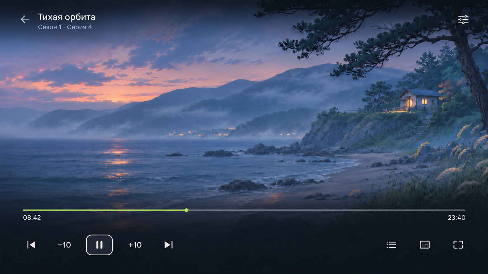

# MJWatch · Утверждённый дизайн плеера
17.11.2026 · Финальный выбор пользователя: первый минималистичный вариант редакции 3, **без подписей кнопок**.

## Зафиксированное решение
- Мягкие верхний и нижний градиенты, тонкая шкала с лаймовым прогрессом, компактные светлые icons.
- Нет dock, постоянных подложек неактивных кнопок и разделителей.
- У текущего фокуса — тонкий светлый контур и небольшая тёмная подложка. Выделение перемещается вместе с фокусом, не закрепляется на Play/Pause.
- **Никаких зрительных подписей действий, в том числе при фокусе, наведении или в tooltip.** Надпись «Пауза» удалена. То же правило относится к «Серии», «Дорожки», «Видео», «Назад» и другим кнопкам.
- Название видео, сезон/серия, время и обозначения −10/+10 остаются как в выбранном макете. «Без подписей» относится к названиям действий, а не к информации о видео.
- Accessibility labels/content descriptions сохраняются у всех кнопок и меняются вместе с действием play/pause. Их читает screen reader; они не выводятся как зрительные подписи.
- Области управления ≥48 dp native и контраст сохраняются: графическая минималистичность не уменьшает hit targets.
- Диалоги/ошибки и пользовательские субтитры остаются с содержательным текстом; запрет относится к подписям транспортных и служебных кнопок плеера.

## Поведение
[REMOTE.md](../REMOTE.md) остаётся источником контракта: скрытые стрелки/OK, порядок всех целей, шкала и preview, подтверждение/отмена, Back, возврат фокуса, 6-секундный таймер, auto-next/auto-skip и системные медиакоманды. Оформление не меняет поведение.

Порядок нижних целей: предыдущая серия → −10 → play/pause → +10 → следующая серия → серии → дорожки → видео. Верхние Назад и Дорожки сохраняются как самостоятельные цели. Нет новых меню, команд, долгих нажатий или мобильного пульта.

В диалогах выбранное значение остаётся отмеченным галочкой, текущая серия — индикатором воспроизведения, текущий фокус — контуром. Старые листы состояний иллюстрируют состав и поведение, а не прежнюю тяжёлую форму transport controls. При будущей реализации применять этот выбранный стиль и не добавлять подписи действий.

## Передача и материалы
Основной финальный макет — player-approved.png, встроенный ImageGen, точечное удаление подписи по присланному пользователем изображению. Целевое окно 16:9; фактический PNG 1672×941, без ресайза или перекодирования. SHA-256 — [manifest.json](manifest.json), задание редактирования — [PROMPT.md](PROMPT.md). Генерация не гарантирует пиксельную идентичность исходному изображению, поэтому геометрия и поведение закреплены требованиями.

[Критерии приёмки](../ACCEPTANCE.md) применяются вместе с поправкой: убрать любые зрительные подписи кнопок, включая подпись фокуса; проверить сохранение semantic labels. Физический пульт и контраст с разными видео проверяются при реализации. Код приложения не изменён, runtime-проверки нового дизайна не заявляются.

Варианты редакций 1–3 — история поиска, не действующие альтернативы. Их указания о подписи при фокусе отменены этим документом.
