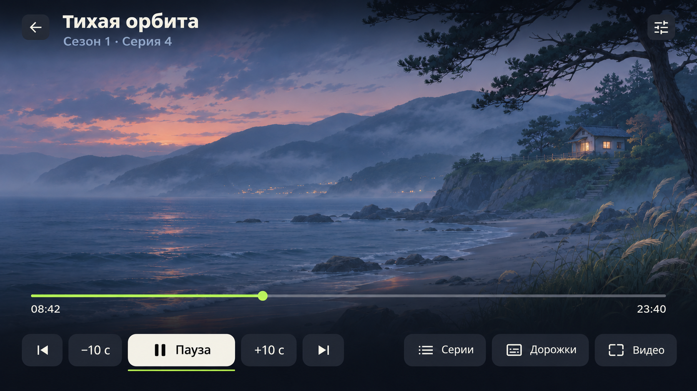
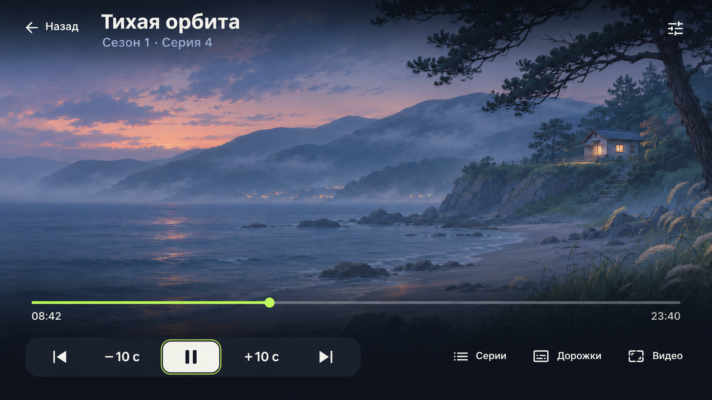
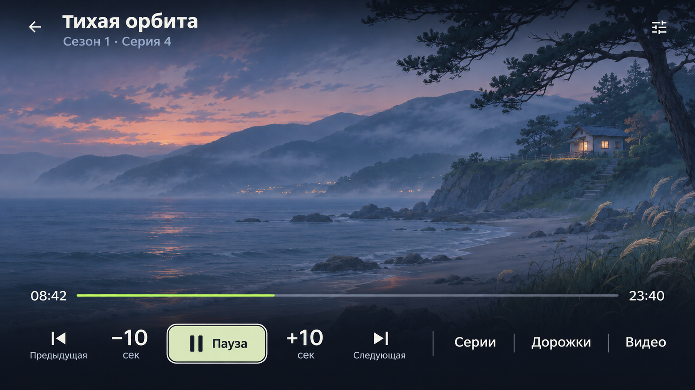

# MJWatch · Плеер · Редакция 2
17.11.2026 · Визуальная доработка по отзыву: «Только кнопки почти не поменялись. А вот идея с градиентом мне нравится».

Градиент сохраняем. Круглая главная кнопка и прежние круговые icons перемотки первой редакции больше не считаются рекомендуемым решением. Ни один из новых вариантов пока не выбран пользователем.

## Новые варианты
Порядок совпадает с порядком показа в чате этой редакции.

### 1 · Soft Keys

Отдельные мягкие прямоугольные клавиши; перемотка обозначена текстом −10 с / +10 с, широкая play/pause с названием действия, служебные кнопки с горизонтальными подписями. Фокус показан светлой заливкой и акцентным подчёркиванием. Это демонстрация фокуса, а не постоянное выделение Play: при переходе к другой цели соответствующее выделение должно переходить вместе с фокусом. Выбранная дорожка по-прежнему отличается галочкой.

### 2 · Ribbon

Одна неглубокая подложка объединяет пять транспортных целей; каждая остаётся самостоятельной кнопкой с прежними событиями. Фокус — светлый прямоугольный сегмент с отделённым контуром. Справа свободные текстовые действия с icons. Подложка не становится одним общим фокусируемым элементом.

### 3 · Type Control

Минимум видимых подложек: крупная типографическая перемотка, подписанные переключения серии, текстовые служебные действия. У фокусируемого действия мягкая прямоугольная подложка с контуром; растровый пример показывает её на паузе. Фокус других целей оформляется так же, не остаётся постоянно на Play.

## Общие требования
- Сохранены мягкие верхний и нижний градиенты, тёмная палитра, Roboto, видео главным слоем.
- Заменены форма/пропорции/группировка controls, отказ от круговой иконографии −10/+10 и круглого Play.
- Порядок целей: предыдущая серия → −10 с → play/pause → +10 с → следующая серия → серии → дорожки → видео. Верхние Назад и Дорожки остаются отдельными целями.
- Полный контракт из [REMOTE.md](../REMOTE.md) сохраняется: скрытые стрелки/OK, предпросмотр и подтверждение шкалы, Back, фокус и таймеры.
- Новая широкая кнопка не должна менять ширину при переходе «Пауза» → «Воспроизвести»; резервировать достаточную ширину под оба названия либо сокращённое «Играть» после отдельной проверки локализации. Вариант 2 использует icon без надписи.
- Отсутствие серии/неполная очередь, disabled и недоступный seek сохраняют текущие правила.
- Фокус на любой цели должен различаться с дивана. Вариант 1 требует отдельной проверки подчёркивания на физическом TV; если оно недостаточно, применять контур по геометрии прямоугольной клавиши. Варианты 2/3 уже показывают контур.
- Независимо от визуальной ширины минимальная native focus target ≥48 dp; измерения макетов не переносить в dp напрямую.
- Контраст текста ≥4,5:1, значимых icons/фокуса ≥3:1 на фактическом композите. Градиент адаптирует затемнение под кадр.
- Растровая геометрия ориентировочная: номинальный viewport 1920×1080, фактические PNG 1672×941; без увеличения/перекодирования. Фоны одинаковы для честного сравнения.
- Старые листы T02–T09 остаются примерами состава/поведения состояний; **их старые транспортные кнопки не являются актуальным визуальным заданием**. После выбора нового направления перерисовать состояния в его стиле.
- Код приложения не менялся. Это ImageGen-макеты, не реализация/интерактивный прототип/новый мобильный пульт.

Задания встроенного ImageGen в [PROMPTS.md](PROMPTS.md), контрольные суммы и фактические размеры в [manifest.json](manifest.json).
