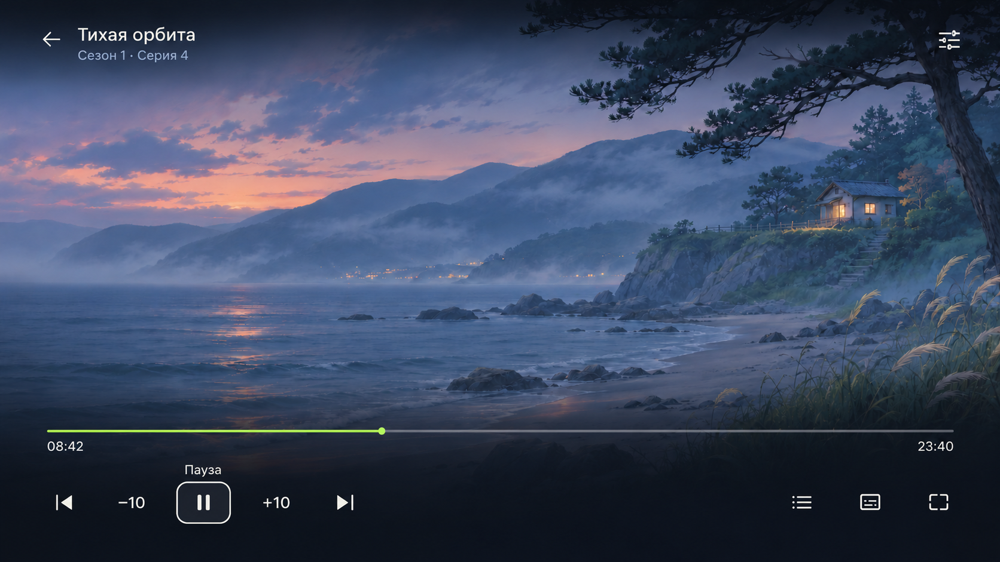
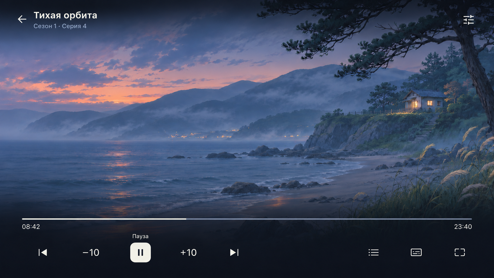
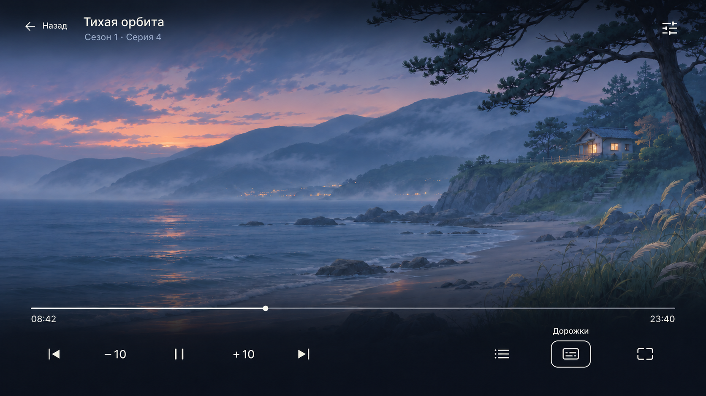

# MJWatch · Минималистичный плеер · Редакция 3
17.11.2026 · Отзыв пользователя: «Уже получше, но хочется чего-то минималистичного».

## Решение
Сохраняем мягкое затемнение поверх видео, убираем постоянные подложки кнопок, общий dock, разделители и подписи всех действий сразу. Одна компактная подпись появляется только у текущего фокуса. Заголовок спокойнее, шкала тоньше. Видеокадр остаётся главным.

Три новых варианта в порядке показа в чате. Окончательный выбор пока не сделан.

### 1 · Airline

Тонкий светлый контур и небольшая тёмная подложка только у сфокусированной цели; небольшой лаймовый участок прогресса сохраняет связь с MJ. На макете фокус «Пауза».

### 2 · Monochrome

Нейтральная шкала и одна маленькая светлая клавиша на месте фокуса. Остальные цели без подложек. Монохромная палитра — предложение, не уже согласованная смена фирменного акцента.

### 3 · Quiet Focus

Нет залитых кнопок. Только тонкий светлый контур вокруг текущего фокуса и его подпись. На макете фокус «Дорожки», пауза выглядит обычной иконкой — это демонстрирует перенос выделения между целями.

## Сохраняем поведение
Контракт [REMOTE.md](../REMOTE.md) полностью действует. Восемь нижних самостоятельных целей остаются в прежнем порядке: предыдущая серия → −10 → play/pause → +10 → следующая серия → серии → дорожки → видео. Верхние «Назад» и «Дорожки» сохраняются. Никакие действия не спрятаны в новый объединённый пункт.

Скрытые стрелки/OK, предпросмотр шкалы и подтверждение/отмена, таймер 6 с, Back, возврат фокуса, автопереход, аппаратные и системные медиакоманды не меняются. Пауза не закрепляется отдельным постоянным выделением; текущий контур/заливка и подпись перемещаются вместе с реальным фокусом.

## Детали для будущего оформления
- Номинальная сетка 1920×1080; PNG фактически 1672×941. Иллюстративные размеры не переносить в dp напрямую.
- Иконки ориентировочно 28–32 reference px, шкала 2–3 px; подписи времени и фокуса ориентировочно 22–24 px, заголовок 28–32 px. На native TV адаптировать размеры под density и читаемость с дивана, не уменьшать важные подписи ради чистоты.
- Минималистична видимая графика, а не область управления: native target ≥48 dp. Позиции целей не меняются при фокусе.
- Место под единственную подпись фокуса зарезервировано между шкалой/временем и кнопками; она не перекрывает время и субтитры. Длинное название допускает перенос в зарезервированной области; размер кнопок не изменяется.
- Все icons имеют постоянные accessibility labels, даже когда зрительная подпись скрыта. Анимация подписи не задерживает фокус или OK. Субтитры и semantic focus имеют прежнее поведение.
- Фокус отображается сразу. Контур минимум 2–3 px reference с тёмным зазором, без свечения/scale. В варианте 2 светлая заливка является фокусом и переносится на любую активную цель; выбранная дорожка по-прежнему имеет галочку в диалоге.
- Нефокусные кнопки не делать полупрозрачными до потери контраста. Текст ≥4,5:1, icons/фокус ≥3:1 по итоговому композиту. Для этого используется локальный градиент.
- На шкале сохраняется отдельная крупная зона фокуса, контур при фокусе, кандидат времени, подтверждение/отмена. Тонкая линия в основном состоянии не уменьшает область навигации.
- Нет нового меню, долгого нажатия, thumbnail-предпросмотра, мобильного пульта или изменений Media3.
- Листы состояний первой редакции иллюстрируют состав и поведение, но их тяжёлые транспортные кнопки не актуальны. После выбора направления обновить эти листы.
- Визуальные макеты просмотрены. Проверка физического пульта, контраста и читаемости на устройстве относится к будущей реализации; в этой поставке приложение не менялось.

## Материалы
Создано встроенным ImageGen с приложенным референсом предыдущего макета; исходные PNG скопированы без ресайза. [PROMPTS.md](PROMPTS.md) — задания; [manifest.json](manifest.json) — размеры, имена и SHA-256. Фон — демонстрационный видеокадр, а не обязательная новая подложка приложения.
