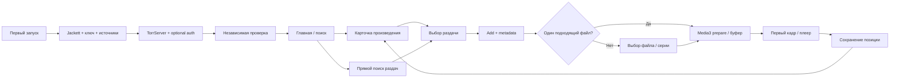

# Экраны, состояния и навигация

## Основной путь

Настроенный, но offline сервер не блокирует вход в приложение. Неуспешная проверка позволяет сохранить параметры с текстом «Не проверено». Optional каталог добавляется отдельно после двух основных подключений.

## Карта экранов

| Экран / макеты | Вход и основное действие | Back / exit |
|---|---|---|
| Home T01/M01 | Категории, hero, продолжить, подборки; card → detail | TV: из контента в rail, из rail системный exit; mobile root → system |
| Detail T02/M02/A01 | Новый просмотр → releases; resume → прежний file; bookmark | Вернуть item+scroll+focus исходного списка |
| Releases T03/M03 | Фильтры, выбор; TV OK подтверждает, mobile row выбирает + CTA подтверждает | Закрыть sheet/screen, сохранить фильтры в этой сессии |
| Files T04/M04 | Выбрать series/file; continue или restart | Вернуться к releases; после add не удалять torrent |
| Preparing T05/M05 | Реальные stages, cancel | Отменить session; вернуться к предыдущему выбору |
| Player T06/M06 | Transport, seek, audio, subtitles, speed, source | Panel → закрыть panel; основной player → detail и сохранить |
| Search T07/M07 | IME, query, catalog/releases, filters | Сначала закрыть IME; затем предыдущий экран |
| Library M08 / TV rail history+bookmarks | Продолжить/Буду смотреть/История | Top-level back; context menu → исходная карточка |
| Settings T08/M09/M10 | Connections/playback/theme | Не терять введённые данные; при несохранённых изменениях Save/Discard/Cancel |
| Setup T09/M11 | Два шага + check/import | Назад по шагам; введённые значения сохраняются в draft |
| Error T10/M12 | Retry/settings/contextual source choice | К предыдущему доступному экрану |
| Empty M13 | Clear filters/edit query | Сохранить query, не выдавать network error за empty |

У tablet top-level пункты соответствуют mobile: Главная/Поиск/Моё/Настройки. Изображённые дополнительные library icons на широкой rail иллюстрируют быстрый доступ к вкладкам «Моё»; не создавать разные модели данных.

## Машина состояний просмотра

`Idle → ResolvingRelease → AddingTorrent → WaitingMetadata → SelectingFile? → PreparingPlayer → Buffering → Playing ↔ Paused → Ended`.

Из network стадий → `RecoverableError(stage, safeCode, retryContext)`; из любой стадии до Playing → `Cancelled`. Во Playing rebuffering не создаёт новую history entry. Одноразовые side effects (open player, launch IME, snackbar) не повторяются после поворота экрана. Rotation и process restore не повторяют add автоматически без проверки session.

Начальный button disabled только в процессе его действия, Cancel всегда доступен. Повтор после error продолжает с безопасного этапа: ready handle можно переиспользовать, expired stream request пересоздать. Fake timer не означает first frame.

## Пульт TV

| Контекст | Кнопка | Результат |
|---|---|---|
| Rail | Up/Down | Между иконками; selected destination не меняется от focus без OK |
| Rail | Right | Remembered content node |
| Полка | Left/Right | Соседняя карточка; в начале Left → rail |
| Полка | Up/Down | Соседняя полка/категория, сохраняется x |
| Card | OK | Открыть detail |
| History card | Long OK | Меню: убрать из истории / в список; short OK подавляется |
| Player UI hidden | OK/PlayPause | Pause/play и показать controls |
| Player UI hidden | Left/Right | Seek −10/+10 с; удержание с throttling, показывать preview position |
| Player UI hidden | Up | Показать controls, focus на выходе |
| Player UI hidden | Down | Показать controls, focus play/pause |
| Нижние controls | Up | Timeline; ещё Up скрывает UI |
| Timeline | Left/Right | Изменить preview; OK commit; Back отменить preview |
| Любая modal panel | Back | Закрыть panel, вернуть focus открывшей кнопке |
| Основной player | Back | Выйти к detail, не застрять в бесконечном «сначала скрыть controls» |

UI скрывается через 4 с бездействия только во время Playing и без открытой панели/accessibility interaction. Subtitle/audio panel — список с selected radio; отключение subtitles всегда отдельный пункт. Disabled track может иметь объяснение. Изменение track не сбрасывает позицию.

## Mobile / планшет

Основной player: single tap toggle controls; double tap left/right ±10 с; жестам соответствуют видимые transport buttons. Lock controls показывает кнопку unlock; системный Back остаётся рабочим. PiP — видимая кнопка и optional auto-enter при Home, если пользователь включил. Back из player не отправляет видео в PiP вместо ожидаемого выхода. Portrait player поддерживается, auto-landscape не ломает system orientation lock. В планшетной двухпанельной навигации Back сначала снимает selection/detail, затем уходит из destination.

Next episode: только известный следующий эпизод и file mapping. На Ended показать «Следующая серия»/«К карточке», без автозапуска по умолчанию. Optional autoplay user setting: видимый 10-секундный countdown, отменяемый пультом/касанием. Нет подтверждённого next file → никакого угадывания по largest file.

## Обязательная матрица данных и ошибок

| Состояние | Сообщение / сохранение | Действия |
|---|---|---|
| Loading catalog | Skeleton реальных размеров | Back/cancel при отдельном поиске |
| Пустая история | «Здесь появится то, что вы смотрели» | Открыть поиск |
| Пустое избранное | «Сохраните фильм на потом» | Открыть каталог |
| Metadata выключены/нет постера | Neutral icon + original title; нет чужой картинки | Поиск раздач / настроить каталог |
| Offline | Cached library + stale label | Повторить; настройки |
| Torznab 401 / XML auth error | «Проверьте API-ключ Jackett» | Изменить ключ; без авто retry |
| Часть индексаторов timeout | «Ответили 2 из 3 источников» + результаты | Повторить только ошибочные |
| Все индексаторы недоступны | «Не удалось выполнить поиск» | Retry/settings; не «ничего нет» |
| 0 results | M13, сохранён query | Clear filters/edit |
| TS timeout/DNS/TLS | M12/T10, release сохранён | Retry/settings/back |
| TS auth failed | «TorrServer отклонил доступ» | Login/password settings |
| Metadata долго | Stage + elapsed, реальная статистика | Cancel; другая release при доступном сервере |
| Нет video files | «В раздаче не найдено видео» | Все файлы/другая release |
| Episode ambiguous | Исходные filenames, без ложных номеров | Manual select |
| Ноль сидов | «Пока нет доступных источников данных» если реально нет пиров/bytes | Wait/другая release |
| Stream interrupted | buffering, позиция сохранена | Bounded retry, затем retry/source/back |
| Codec unsupported | «Устройство не поддерживает этот формат» | Другой track/release; не бесконечная перезагрузка |
| Seek не поддерживается | Timeline disabled + explanation | Продолжать просмотр; не ложный прыжок |
| Раздача удалена на сервере | Saved title/position remain | Re-add from known release or choose other |
| Конфиг невалиден | Field-level error; draft retained | Исправить / отменить |

## Сохранение и восстановление

Повторное открытие приложения восстанавливает top-level destination, локальную историю и предпочтения. Не запускает видео со звуком автоматически. Навигационные restoration keys не содержат секретов/полных magnet. Смена темы не перезапускает видео. Смена адреса активного TorrServer во время просмотра — диалог «Остановить просмотр и применить»; изменение другого параметра не сбрасывает session.

## Managed TV (дополнение 0.6.2)

Исходный T09 описывает direct-подключения и JSON import. Для managed входа TV
использует тот же системный выбор файла: вошедший телефон → «Добавить телевизор»
→ «Сохранить настройки TV» → перенос файла → TV «Импортировать настройки» →
явная сверка отпечатка → крупный код TV → проверка и подтверждение на телефоне.
Пульт не используется для ввода имени, пароля или PEM. До доверия TLS-запрос не
проходит; ошибка видна рядом с повтором и импортом. Back отменяет опрос; истечение
кода предлагает получить новый. QR и автоматическое обнаружение этим сценарием
не предусмотрены. На TV нужен системный поставщик документов для импорта.

## Managed TV через QR (новый запрос пользователя)

TV «Войти на сервер MJWatch» → QR появляется автоматически → вошедший телефон
«Аккаунт → Добавить телевизор → Сканировать QR» → TV показывает аккаунт и сервер,
пользователь нажимает «Подключить» → телефон показывает реальное устройство и
запрашивает «Подключить телевизор» → TV автоматически открывает главный экран.
Адрес, пароль, код и сертификат на TV не вводятся; файл переносить не нужно.
Телефон и TV должны быть в одной локальной сети. Отмена с телефона или отклонение
на TV закрывает попытку и обновляет QR; Back прекращает ожидание. Просроченный QR
имеет явное обновление. Прежний путь 0.6.2 находится в дополнительных способах.
