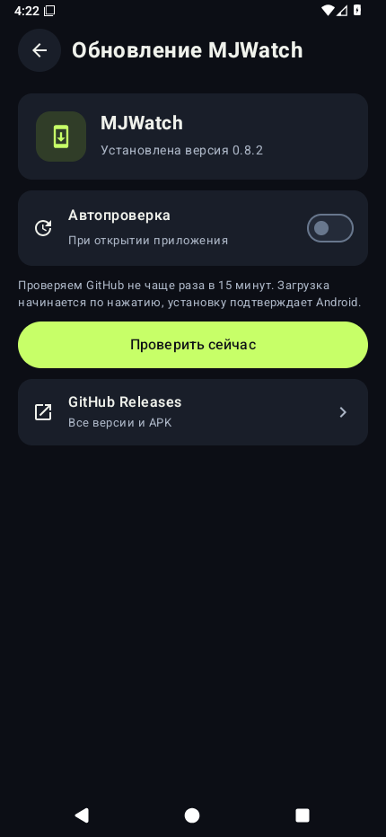
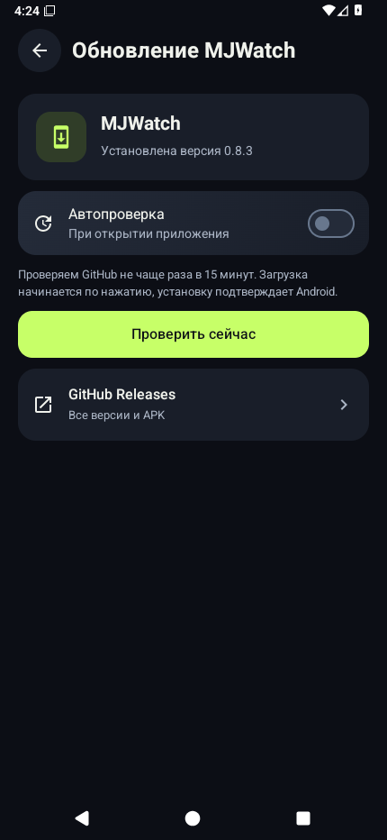
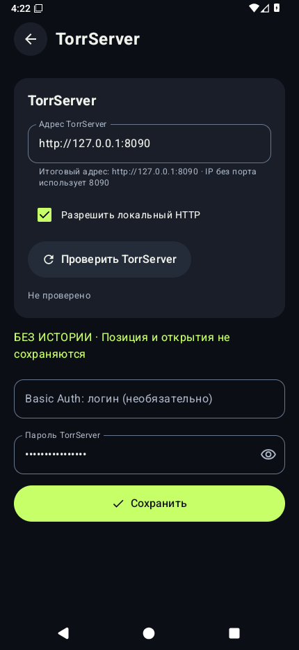
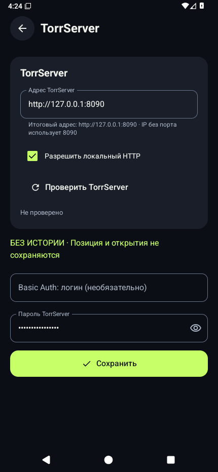
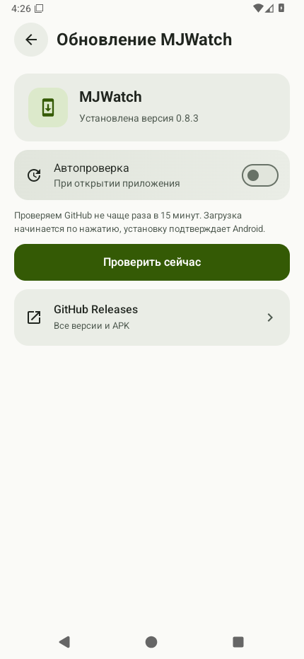
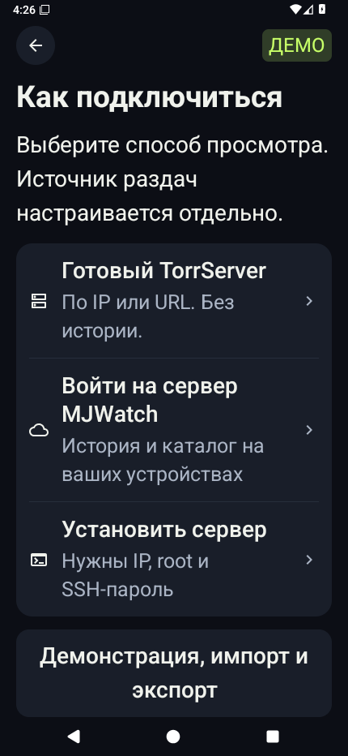
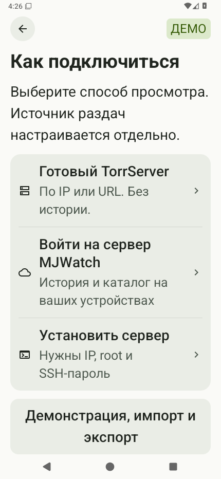

# MJ Family controls — 0.8.3

Проверка 16 ноября 2026. Правила: COL-01/02/03, TYP-01, GEO-01/02, CMP-01/02/03/04/08/10, A11Y-01 семейного [стандарта](../MJ-FAMILY-DESIGN.md).

## Что изменилось

- Общая Action: radius 16 dp, primary от 52 dp, secondary от 48 dp, horizontal padding 24/20 dp, gap 8 dp. Подписи целиком переносятся и выравниваются по центру. TV label/icon получают фактический focused/disabled content color.
- Chip: минимум 48 dp; TV label 18/24 sp. Selected остаётся спокойной заливкой, focus обозначается отдельным кольцом без увеличения геометрии. Tabs имеют минимум 48 dp; badges radius 8 dp.
- Switch и checkbox в настройках управляются всей строкой, имеют одну toggle-семантику и не удваивают активацию. Изменение черновой настройки не сохраняется до Save.
- Поля используют radius.selector 12 dp, группы — radius.group 20 dp. UI type scale задана в теме. Error/onError/container определены для Dark и Light.
- Постоянный диагональный градиент surfaceHigh → surface выделяет автопроверку, компактное уведомление об обновлении и статус подготовки потока. На экране не больше одного такого акцента в видимой области; кнопки, обычные списки и launcher остаются однотонными. Ripple не превращается в постоянное мерцание.

## Проверки

- `sh scripts/check.sh`: 60 core unit tests, mobile/TV lint, debug и release APK — успешно.
- Android phone API36, 430×932 dp: ControlsUiTest (3), SettingsUiTest (2), CatalogSectionsUiTest (2) — 7 tests успешно. Проверены нажатия по текстовой стороне и по thumb switch, checkbox без сохранения до Save, перенос полного текста кнопки при 2× font scale в Dark/Light, независимые подключения и фильтры.
- Android TV API36: RemoteNavigationUiTest — 2 tests успешно с чистыми данными fixture. Проверены фокус полезного контрола, повторный OK для воспроизведения, D-pad и выход с timeline без перемотки.
- Повторный TV-прогон с сохранённой историей предыдущего теста не нашёл ожидаемую Pause; после очистки только временного тестового приложения suite прошёл. Исходный suite не сбрасывает позицию видео между ручными запусками.
- API37: Espresso не смог инициализировать InputManager до проверки экранов. Для локальной UI-проверки созданы отдельные временные API36 AVD; пользовательский API37 AVD не перенастраивался.
- Все 16 пар контраста tokens.json пересчитаны генератором. На градиенте минимум onSurfaceVariant: Dark 6.86:1, Light 5.83:1; outline: 3.12:1 / 3.92:1. Оба конца градиента — непрозрачные монотонные поверхности.

Полный CI №34 подтвердил build/server/lint, но остановил публикацию: старые сквозные тесты искали contentDescription отдельного switch; телефонные сценарии также зависели от физического tap под clipboard overlay, системного Back при IME и фонового запуска Activity. Сквозные тесты переведены на семантику целой строки; explicit accessible activation приглашения, toolbar Back с ожиданием перехода и ActivityScenario сохраняют исходные проверки безопасности и состояния. Локальный полный TV-набор после этого прошёл.

CI релизного commit отдельно выполняет полный phone API35 и TV API36 suite и публикацию с сохранёнными сертификатами. Локальный debug APK не является доказательством проверки подписанного release APK.

## Опубликованный релиз

[0.8.3 / test-35](https://github.com/MJSasha/mj-watch/releases/tag/test-35), versionCode 1035, исходники `0cc2dfbb5b88648cf1d058a91948e51c4626fa3b`. [CI №35](https://github.com/MJSasha/mj-watch/actions/runs/43898948733): build, phone API35, TV API36 и publish-release — success. Релиз обычный Latest, без prerelease.

Фактически скачанные MJWatch-mobile.apk и MJWatch-tv.apk проверены по package ID, версии, размеру, SHA256, отсутствию debuggable и прежнему сертификату из scripts/test-signing-cert.sha256. update.json и все три строки SHA256SUMS.txt совпадают с файлами. Подпись серверного manifest и хеши всех payload проверены OpenSSL/Python; ZIP-поставка идентична server assets внутри обоих APK.

На скачанных подписанных APK выполнены ещё 10 phone-сценариев (Controls, Settings, CatalogSections, Invitation, Session, VerticalFlow) и 3 TV-сценария (RemoteNavigation, VerticalFlow) — успешно на API36. APK установлены поверх локальных пакетов с тем же сертификатом; для тестов использованы только чистые данные временных AVD. Локальные проверенные копии сохранены в игнорируемом dist/test-35/.

## До и после

Снимки получены на одном временном телефонном AVD, 430×932 dp, в одинаковых состояниях. До: исходный commit 4396c84 (0.8.2), после: 0.8.3. До/после не сравнивают разные приложения или демонстрационные HTML-компоненты.

| Экран | До | После |
| --- | --- | --- |
| Обновления |  |  |
| TorrServer |  |  |

### Постоянный градиент и крупный текст

Не заявляется полная миграция всех 63 правил или полная доступность приложений. TalkBack на физическом устройстве, реальное TV-расстояние и все системные font/display scale комбинации требуют отдельной проверки. MJReader и MJAnime этим релизом не изменены; общее правило добавлено в семейный стандарт и tokens.json.
