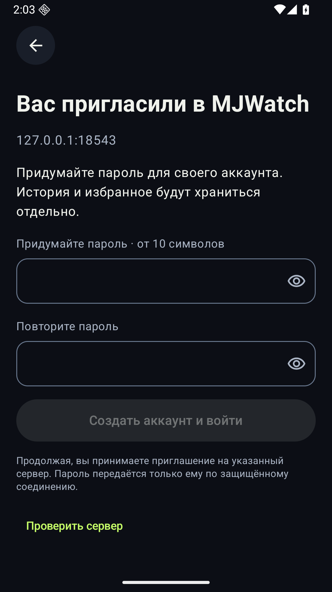
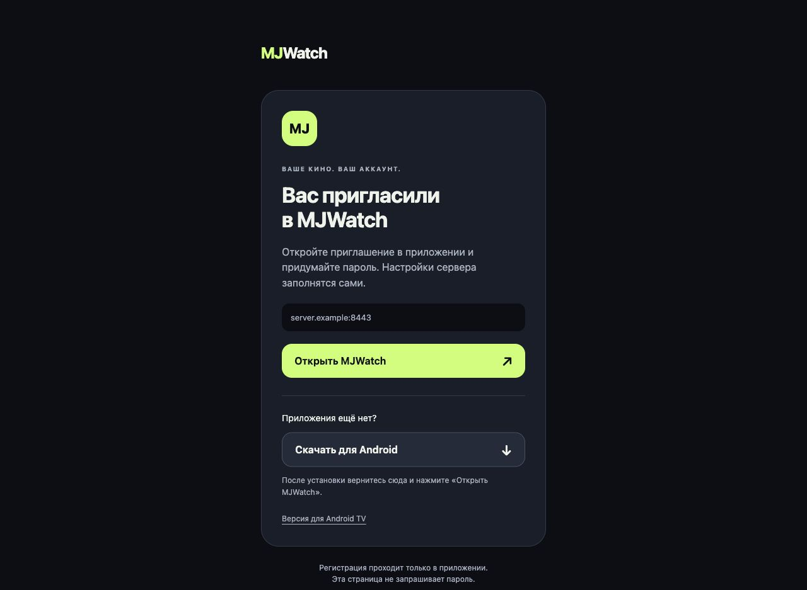

# Приглашения ссылкой — MJWatch 0.8.0

## Сценарий

Владелец: **Пользователи → Добавить пользователя → Поделиться ссылкой**.
Получатель нажимает обычную HTTPS-ссылку: установленный MJWatch открывает экран
«Вас пригласили в MJWatch». Нужно придумать и повторить пароль, затем создать
аккаунт. Адрес, код и сертификат вручную не вводятся; настройки искать не нужно.

Если приложения нет или браузер перехватил ссылку, страница
[приглашения](https://mjsasha.github.io/mj-watch/join/) предлагает открыть MJWatch,
скачать мобильный APK или APK для TV. После установки можно вернуться на ту же
страницу и открыть сохранившееся приглашение. Пароль вводится только в приложении.

Старый JSON-импорт оставлен совместимым. Код одноразовый, срок и отзыв/перевыпуск
проверяет сервер. Открытие страницы, предпросмотр мессенджера и открытие приложения
не принимают приглашение автоматически.

## Ссылка и доверие

- Ссылка содержит адрес HTTPS, одноразовый код и SHA-256 отпечаток публичного CA.
  Полного PEM/JSON, пароля, access/refresh-токенов и приватного ключа в ней нет.
  Поля помещены во фрагмент URL: веб-сервер не получает их в HTTP-запросе, Referrer
  отключён. Страница не обращается к приглашающему серверу, не содержит аналитики
  или веб-формы регистрации. Приглашение всё равно является одноразовым секретом:
  его отправляют адресату через системное «Поделиться», а clipboard помечен sensitive.
- Android App Links привязан к существующему release-сертификату обоих пакетов.
  Файл `/.well-known/assetlinks.json` опубликован в корне **mjsasha.github.io**;
  исходники находятся в `app-links/` и `MJSasha/mjsasha.github.io`. Манифесты
  ограничены `/mj-watch/join/`. Прямой intent со страницы также привязан к пакету.
- При первой регистрации приложение принимает из TLS-цепочки только CA с точным
  отпечатком приглашения, затем стандартный TrustManager проверяет цепочку,
  сроки сертификатов, а OkHttp — имя сервера. Redirect запрещён. Bootstrap не
  отправляет приглашение, пароль или сохранённую авторизацию. Trust-all manager
  и отключение hostname verification не используются.
- После успешной регистрации и snapshot проверенный CA сохраняется только для
  этого origin. Несовпадающее сохранённое доверие не перезаписывается ссылкой.
  Просто открытие ссылки не меняет профиль или сертификаты. При активном
  воспроизведении смена аккаунта запрещена; пароли не сохраняются в saved state.
- Для короткой ссылки с частным CA нужен сервер **0.1.2**. Его TLS-цепочка включает
  публичный CA, проверяемый отпечатком; приватные ключи не передаются. Обычные
  клиенты с уже сохранённым CA продолжают работать. Обновление leaf-сертификата
  по-прежнему использует прежний CA, поэтому ссылки не зависят от ротации leaf key.
  Установки с системно доверенным публичным сертификатом работают без private CA.

## Проверка 16 ноября 2026

Отдельный AVD `mjwatch-release-check`, API 36 arm64, HTTPS-fixture 18543/18544.
Реальные пользовательские приглашения не отправлялись.

- **59 unit-тестов, 0 ошибок**; новые проверки короткого формата, round-trip direct
  intent, чужого хоста/HTTP, повторных полей, неверного CA и отсутствующей цепочки.
- `sh server/check.sh`: race/vet, новый тест TLS-цепочки и 7 packaging-проверок —
  успешно. Проверены добавление публичного CA, отсутствие дубликата в цепочке и
  работа обычного сертификата без локального `ca.crt`.
- Lint/debug/release обеих платформ — успешно. Во всех четырёх APK встроен сервер
  0.1.2; SHA-256 каждого вложенного файла совпал с подписанным manifest.
- Полный phone-набор: **22 выполнено, 18 явно пропущено, 0 ошибок**. Флаги:
  `invitationFixture=true`, `issueFixture=true`. InvitationLinkUiTest проверяет
  холодный ACTION_VIEW, onNewIntent на уже работающем приложении, создание двух
  аккаунтов, отказ использованному коду и неправильному отпечатку без изменения
  доверия/профиля. Существующие legacy import, пользователи, каталог и просмотр
  продолжают проходить. Тесты пользователей прокручивают длинный список к owner.
- Полный TV-набор: **6 выполнено, 11 явно пропущено, 0 ошибок**. Существующие
  пользователи, плеер, D-pad и локальный первый кадр сохранены.
- Публичный assetlinks.json проверен на точное совпадение с release-fingerprint
  из `scripts/test-signing-cert.sha256` и обоими package ID. Страница просмотрена
  в браузере; ссылки ведут на Android intent и Latest APK. Использован только
  вымышленный preview `server.example`; странице не передавали реальные коды.

Debug UI-тесты запускают explicit Activity intent, поскольку debug-подпись не
добавляется в публичную Android-ассоциацию. Проверка автоматического выбора
приложения выполняется с опубликованным release APK: `pm verify-app-links
--re-verify dev.mjwatch.mobile`, затем `pm get-app-links` и неявный ACTION_VIEW.
Внешние мессенджеры и пользовательский выбор «Всегда открывать в браузере» могут
влиять на доставку; кнопка «Открыть MJWatch» на странице даёт явный запуск.

API: [Android App Links](https://developer.android.com/training/app-links/about),
[публикация ассоциации](https://developer.android.com/training/app-links/configure-assetlinks).

