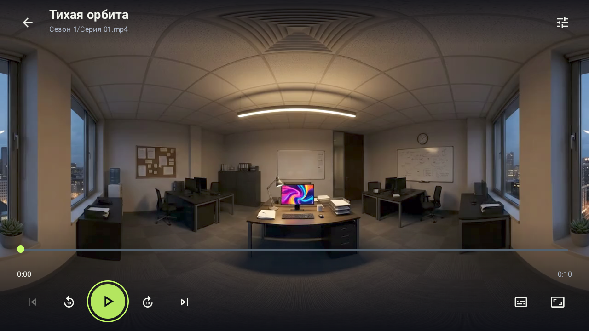

# Переключение серий и сон экрана — 0.8.5

Исправление [issue #13](https://github.com/MJSasha/mj-watch/issues/13), с уточнением пользователя: в плеере нужны предыдущая/следующая серия. Кнопки ±10 секунд остаются на месте.

Очередь составляется из всех видеофайлов текущей раздачи, независимо от фильтра перед запуском. Sample исключаются, порядок числовой — сезон, серия, имя. Каждый элемент сохраняет собственные serverFileId, path и managed contentKey. Переключение сохраняет прежний прогресс, загружает сохранённую позицию выбранной серии и обновляет Intent для восстановления после пересоздания Activity. За пределами очереди кнопки недоступны; автоматический переход после завершения не добавлен. Поддержаны MEDIA_NEXT / MEDIA_PREVIOUS.

`PlayerView.keepScreenOn` включается во время воспроизведения и буферизации при playWhenReady. Пауза, завершение и остановка освобождают запрос. Системные настройки таймаута не меняются.

Парсер сезонов отдаёт приоритет диапазону перед словом «сезон». Название «1–3 сезоны: 1–24 серии» даёт сезоны 1, 2, 3; серии 4–24 не становятся сезонами. Форматы S01–S03 и 2x03 сохранены.

## Проверки

- `sh scripts/check.sh`: 61 core unit test, lint и debug/release сборки обоих приложений — успешно.
- Полный TV API36 instrumentation: `OK (22 tests)`. Опциональные live/managed сценарии без внешнего окружения пропускаются.
- `SeriesPlaybackUiTest` для телефона API36: выбор файла через мобильный экран, переключение на следующую серию, границы очереди, отсутствие sample, сохранение serverFileId, восстановление Activity, MEDIA_PREVIOUS и native keepScreenOn при просмотре/паузе.
- Тот же сценарий на TV API36: отдельные реальные переходы D-pad от play через перемотку к следующей серии, затем OK. Перед каждым переходом проверяется фактический фокус. Системная fullscreen-подсказка закрывается, после неё тест выходит из touch mode.
- `IssueRegressionsTest.seasonFilterDoesNotTreatEpisodeCountsAsMoreSeasons`: русские/английские названия с диапазонами серий, ReleaseFilter и прежние форматы сезонов. Тест воспроизводил ошибку до исправления.

Снимки получены из native runtime тестов на временных AVD. Физические устройства и новый live-сеанс с внешним TorrServer в этой проверке не использовались.




## Проверка опубликованного релиза

16 ноября 2026 опубликован [MJWatch 0.8.5 / test-37](https://github.com/MJSasha/mj-watch/releases/tag/test-37), versionCode 1037, обычный Latest (не prerelease). Исходники: `d22eb090dbecb73b4492dfa2e6fe99c245bacf5a`. Все четыре задачи [CI #37](https://github.com/MJSasha/mj-watch/actions/runs/43911532519) завершились успешно: build, phone API35, TV API36, publish-release.

Скачанные APK проверены через apksigner и aapt: правильные packageName/версия, release без debuggable, SHA-256 и размеры совпадают с update.json и SHA256SUMS.txt. Сертификат совместим с прежними выпусками: `c695e45c49e8f38f44927b763c9fa74bc8a0e70e3a774c4081e91e1e054e7fad`.

Серверная поставка 0.1.3: проверена подпись manifest.json через OpenSSL, размер и SHA-256 каждого payload; содержимое ZIP совпадает с server assets обоих APK.

После установки именно скачанных release APK на временные AVD API36 `SeriesPlaybackUiTest` прошёл на телефоне и TV: `OK (1 test)` на каждом. Проверены переключение серий, границы, пересоздание Activity, media key и удержание экрана во время просмотра с освобождением на паузе.

Контрольные суммы опубликованных файлов:

```text
eab0a8467910318661b194c40123cc8be4fade03d455bc5d923e76cb9894cfed  MJWatch-mobile.apk
95187d1e353c5551d16d7fa1b475c8cc176f83c96532ddfeda28e0de32ec7786  MJWatch-tv.apk
8b5b768761f17d0a8e7fc9cf35aedfbabb75c3b30d4bdbb4602cbd8521c5bf7b  mjwatch-0.1.3-supply.zip
```
