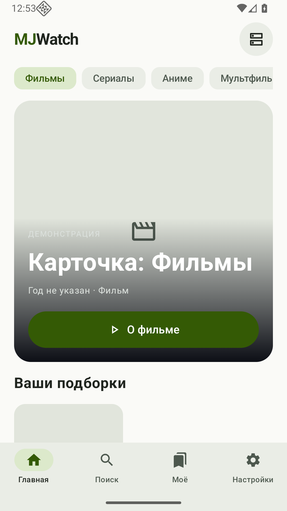
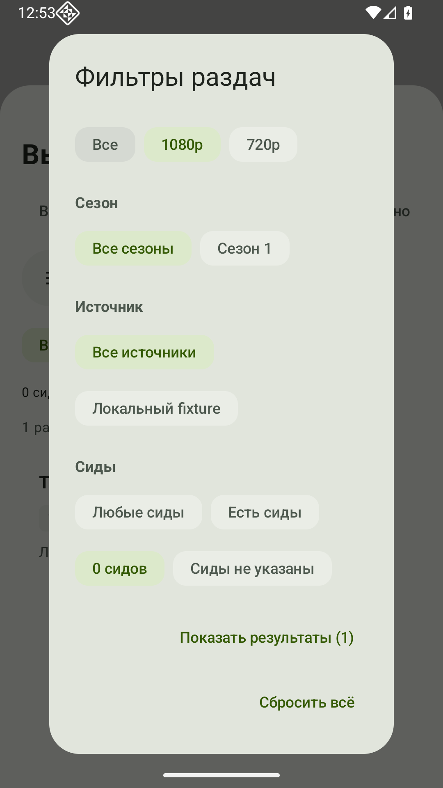
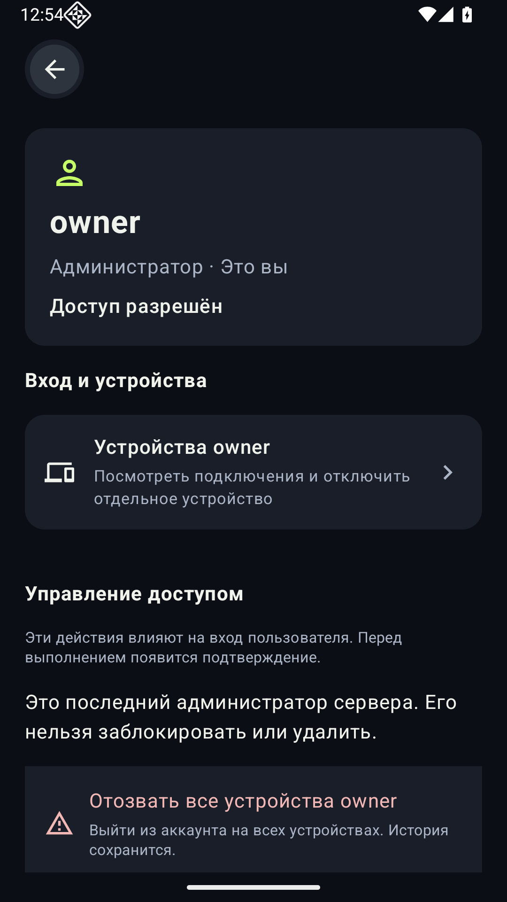
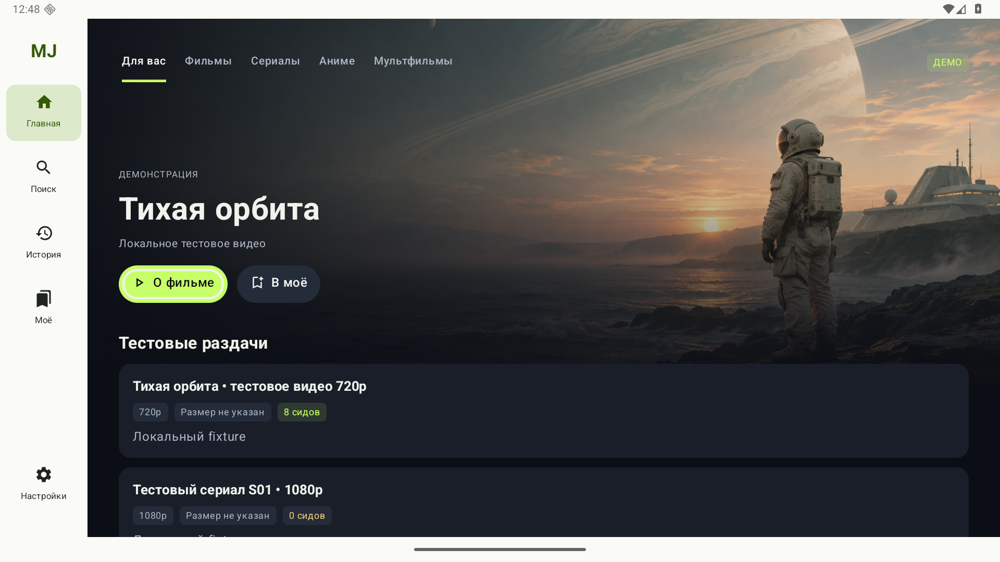
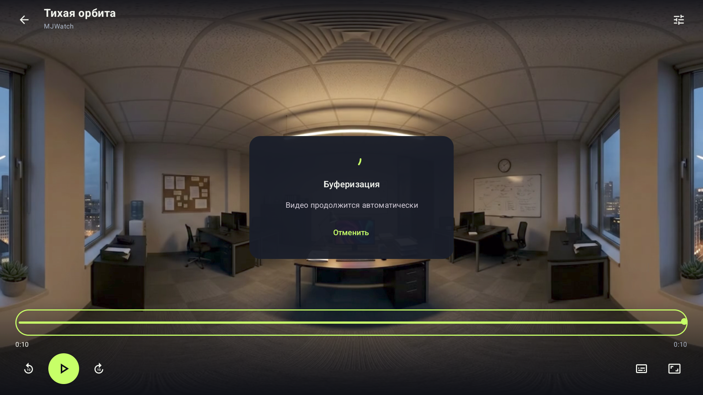

# Issues #8–#12 — каталог, пользователи, раздачи и TV

Исправления для MJWatch 0.7.1 / локальный versionCode 16. Серверная поставка — 0.1.1.
Требования: [#8](https://github.com/MJSasha/mj-watch/issues/8), [#9](https://github.com/MJSasha/mj-watch/issues/9), [#10](https://github.com/MJSasha/mj-watch/issues/10) с приложенным снимком, [#11](https://github.com/MJSasha/mj-watch/issues/11), [#12](https://github.com/MJSasha/mj-watch/issues/12).

## Каталог (#8–#9)

Добавлены пять разделов: «Для вас», «Фильмы», «Сериалы», «Аниме», «Мультфильмы».
Раньше вкладки фильтровали только одну страницу trending/all/week; нужного жанра могло не оказаться на этой странице.
Теперь разделы запрашивают отдельные подборки TMDB Discover с типом movie/tv, жанром анимации и языком для аниме. «Мультфильмы» включают анимацию любых стран; японская анимация также имеет отдельный раздел. Фильмы и сериалы исключают анимацию.

Direct-клиент и managed-сервер используют одинаковые ограничения. Ответы Discover получают явный media_type; карточки сериалов сохраняют тип tv. Сервер принимает только перечисленные категории, не превращая прокси в произвольный API. Ключ TMDB остаётся на сервере, изображения переписываются на существующий авторизованный прокси.

Кеш разделён по профилю и категории; прежний кеш «Для вас» сохранён. Выбор вкладки хранится в ViewModel и сохраняется при Back и смене конфигурации Activity. Загрузка и пустое/ошибочное состояние больше не подменяются фиктивным фильмом. Для managed-разделов нужен сервер **0.1.1**: старый сервер игнорировал category, поэтому приложение проверяет маркер ответа и объясняет необходимость обновления вместо показа той же подборки во всех вкладках.

API: [Discover Movie](https://developer.themoviedb.org/reference/discover-movie), [Discover TV](https://developer.themoviedb.org/reference/discover-tv).

## Пользователи (#10)

На странице человека выделены карточка имени/роли/доступа, группа «Вход и устройства» с иконками и пояснениями, затем отдельная группа управления доступом. Опасные действия описывают последствия и сохраняют адресные подтверждения. Последний администратор по-прежнему защищён клиентом и сервером. Список объясняет, для чего выбирать пользователя; создание и приглашения сохраняют отдельные страницы и состояние.

## Фильтры (#11)

Варианты сгруппированы по качеству, сезону, озвучке, источнику, сидам и языку; кнопки переносятся по строкам. Качество берётся из доступных раздач, не из длинного списка отсутствующих вариантов. Доступны быстрые качество/сезон, счётчик активных фильтров, явный общий сброс и живая кнопка с числом результатов. Выбранные дополнительные ограничения видны над результатами. Озвучка и язык остаются предположениями по названию, а не обещанием фактических дорожек.

## TV (#12)

- F1: шкала обрабатывает ←/→ как перемотку на 10 секунд, ↑ переводит на верхнюю кнопку дорожек, ↓ — на воспроизведение. Все нижние кнопки имеют явный выход вверх к шкале.
- F2: у основных действий контрастный контур 3 dp с зазором. Действия на изображениях используют цвета кинематографической области; на светлой подложке — цвета светлой темы.
- F3: кинематографическая главная имеет тёмную палитру и явный LocalContentColor независимо от общей светлой темы. Это исправляет также неявно наследовавшие цвет заголовки и карточки. На снятом светлом TV-кадре контраст текста героя #F0F2EC относительно самого яркого пикселя проверенной полосы фона рядом с заголовком — **9.25:1** (sRGB). Это выборочный замер, не проверка всех пикселей и состояний.
- F4: способы подключения и формы получают начальный фокус внутри содержимого; он устанавливается после кадра без задержки, способной перехватить быстрое OK. Ошибка подготовки фокусирует восстановление, отсутствие ссылки — возврат к раздачам. Плеер восстанавливает фокус при возвращении фокуса окна.
- F5: навигация постоянно показывает короткие подписи разделов.
- F6: первое OK выбирает серию, повторное OK запускает её. На экране есть подсказка; отдельная кнопка «Смотреть» сохранена.
- F7: `und` заменён на «язык не указан»; известные языки отображаются по-русски вместе с названием дорожки.

## Проверка

16 ноября 2026, отдельный AVD `mjwatch-release-check`, API 36 arm64. Телефон: 1080×1920, density 420; TV: 1920×1080, density 240. HTTPS-fixture на отдельных портах 18543/18544, CA и аккаунты тестовые.

- `:core:testDebugUnitTest` — **56 тестов, 0 ошибок**. Новые проверки: выбор отдельных Discover-запросов, media_type и раздельный кеш/офлайн-восстановление категорий.
- `:app-mobile:lintDebug`, `:app-tv:lintDebug` — успешно. Debug и release APK обеих платформ собраны с подписанной local-test серверной поставкой 0.1.1.
- `sh server/check.sh` — race/vet, 7 packaging-проверок и синтаксис успешно. Новый тест проверяет категории на HTTP-уровне, media_type, прокси изображений, раздельный кеш и отклонение произвольной категории.
- Полный phone instrumentation-набор: **20 выполнено, 18 пропущено по явным fixture-флагам, 0 ошибок**. Включены CatalogSectionsUiTest и все четыре UserManagementUiTest с `issueFixture=true`: приглашения, перевыпуск, устройства, блокировка/удаление, последний администратор, длинное имя и крупный шрифт. Каталог проверен по разным карточкам и Back; два фильтра совместно оставляют одну раздачу, общий сброс возвращает обе.
- Полный TV instrumentation-набор: **6 выполнено, 11 пропущено по явным fixture-флагам, 0 ошибок**. Включены RemoteNavigationUiTest (2), UsersTvUiTest, BufferingUiTest, SessionTest и VerticalFlowTest. Проверены повторный OK, реальное локальное видео, фокус шкалы/верхнего/нижнего ряда, отсутствие seek при вертикальных переходах, seek вправо, понятное имя неизвестной дорожки и фокус форм.

В тесте навигации один раз задаётся начальный фокус выбранного файла/кнопки; дальнейшие переходы выполняются D-pad событиями. Системная подсказка fullscreen на телефонном Android image закрывается отдельно; реальный D-pad выводит Android из touch mode перед проверкой кнопок плеера.

Реальный TMDB с пользовательским ключом не запрашивался: запросы проверены перехватчиком и Go HTTP-fixture, UI использует явные кешированные карточки. Не проверены физический Android TV/пульт, длительный фильм и переключение нескольких реальных дорожек. Local-test подпись серверной поставки предназначена для локальной проверки; CI публикует с прежними стабильными ключами.

## Исходные снимки успешных прогонов

TV-снимок шкалы поймал краткую буферизацию после seek; он показывает контур фокуса. Исход и переходы проверены отдельными assertions, наличие кадра — Media3 callback в VerticalFlowTest. Системные панели на снимках относятся к телефонному образу эмулятора.
