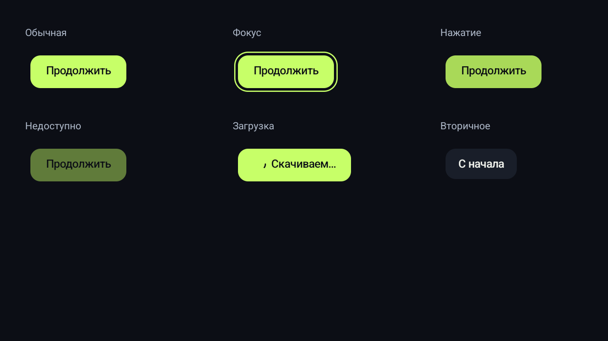
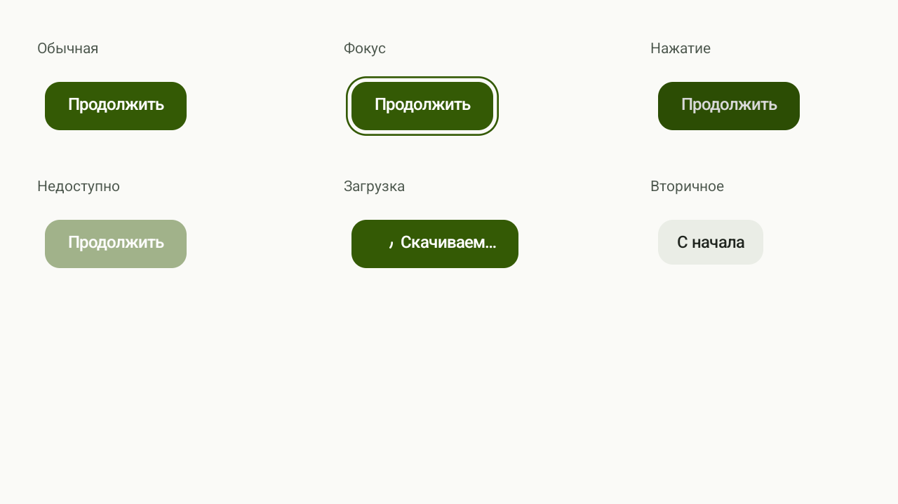

# TV-кнопки по образцу — 0.8.4

Эталон предоставлен пользователем 16 ноября 2026: [reference.png](tv-buttons/reference.png). Все состояния отрисованы нативным Compose for TV; изображение не используется вместо работающей кнопки.

- Основная кнопка: minHeight 52 dp, radius 16 dp, padding 24×12 dp, label 18/24 sp / 500. Вторичная: minHeight 48 dp, surface/onSurface и padding 20×12 dp.
- Фокус: неизменная заливка и геометрия, внешний primary-контур 2 dp и чистый зазор 4 dp. В TV Material 1.0.1 `Border.inset` задаёт положение центра stroke; для этого нужен положительный inset 5 dp. Прежний отрицательный inset рисовал кольцо внутри заливки. Общий helper исправлен также для фильтров, карточек и rail.
- Нажатие: яркость заливки/текста 85%, без увеличения. Недоступно: opacity 45% обычных цветов поверх background.
- Loading: нативный spinner 20 dp / stroke 2 dp, полная яркость, busy/disabled semantics, сохранение D-pad фокуса и блокировка callback. Нужен отдельный guard, поскольку TV Material добавляет собственный alpha к disabled content. Подключено к проверке/загрузке обновлений и сохранению настроек.

## Проверки

`sh scripts/check.sh`: core unit tests, lint, debug/release обоих APK — успешно. TvButtonsUiTest проверяет неизменную геометрию при focus/press/loading, активацию D-pad, отсутствие callback при loading/disabled и восстановление после загрузки. Видимость фокуса проверяется по пикселям screenshot: внешний stroke имеет контраст с зазором не ниже 3:1 в Dark и Light. Это ловит прежний случай, когда семантический фокус был, а кольцо сливалось с кнопкой.

Снимки ниже получены на временном Android TV API36 AVD; индикатор нативный и анимируется, поэтому длина его дуги зависит от кадра. TalkBack на физическом TV и реальное расстояние просмотра отдельно не проверялись.

