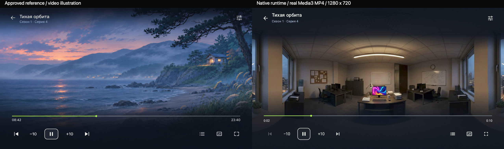

# Android TV player: approved design implementation (#32)

17 November 2026. Implementation and local emulator evidence; independent review and the next signed stable release are still required.

Code under test: `91dcb110f96f94426c4110a762e06d2a96500504`. Base: `6b801abab2fe02b15d73aa5d33ff58d48002d618` (`codex/issue-26-phone-tv`, PR #31). Initial clone was `1c66118`; it was fast-forwarded before editing. The later base updates touched release documentation/workflows, not this player UI. Published branch head is recorded by the PR and its checks; subsequent evidence commits do not change application code.

Production changes are confined to `TvPlayerControls.kt` and a TV-only native ListView selector in `PlaybackActivity.kt` (12 lines plus two call sites). `TvPlaybackState`, RemoteReceiver, MediaSession, history, server and the phone/TV contract are unchanged. `PlaybackActivity.kt` overlaps PR #31 as a file; this patch only decorates existing dialogs after show(), preserving their listeners and managed playback flow. Version numbers, signing and release workflows remain owned by the preceding #26 release at this stage. No changes were made in the shared project checkout or the active release checkout.

## Approved target and comparison

The exact approved PNG and final contract were copied from `codex/player-design-approved` / `96ba8c2bf713e2fdc2e0210ad3d5cd5f3c54d513`, without merging alternative design history. The [final specification](../../../design/player-soft-v1/final/README.md) overrides older focus-label instructions. The sea is an illustration, not a runtime background.



Both panels use the same 16:9 comparison viewport. The approved original (1672×941) is preserved unchanged under `design/player-soft-v1/final/`; only the comparison presentation fits it to 1280×720. Runtime is an unmodified screenshot of the installed TV APK playing the bundled real MP4 through Media3. The fixture has a 10-second duration and two queue entries, so its actual time/progress and disabled Previous differ from the illustration.

Visual inspection confirmed soft continuous gradients, a thin lime track and centered marker, compact light icons, no dock/dividers, no persistent Play/Pause fill, one light inset focus outline, and no transport/service action labels or tooltips. At the normalized 720p comparison the track is about y=550 versus y=552 in the reference; the Play/Pause center is about (264,643) versus (260,643). Native 48 dp targets intentionally remain larger than some illustrated glyphs. Native audio/video dialogs retain their existing platform presentation, selected checks and text, with the same inset light focus outline on the active row.

## Checks actually run

| Check | Result / evidence |
| --- | --- |
| All playback JVM tests, including `TvPlaybackStateTest` | 12/12; state machine 6/6, [XML](jvm/) |
| `TvRemoteControlsTest`, fake Player, real D-pad/OK/Back events | 15/15; [log](fake-player.txt) |
| Installed TV APK + ExoPlayer + real bundled MP4, `TvPlayerBehaviorTest` | 4/4 at native 1280×720 / 213 dpi; [log](installed-tv-720.txt) |
| Design/semantics/dialog/media-key scenario, native 1920×1080 / 320 dpi | 1/1; [log](1080p.txt), actual [1920×1080 PNG](1080p/playing-pause-icon.png) |
| Same scenario, 1280×720 / 213 dpi, font scale 2.0 and long Russian title/path | 1/1; [log](font200.txt), [frame](font200/player-play.png) |
| TV debug APK + TV/playback instrumentation APK builds, TV lint, mobile Kotlin compile | Passed; [build log](build.log), [test build](test-build.log), [native-dialog affected checks](dialog-build.log) |

The existing tests cover hidden arrows/OK, held OK, timeline preview/confirm/cancel/blur, Back exit, modal return focus, timeout blockers, automatic skip/next rules and queue boundaries. Real-video tests cover preview and single Back exit, media Next boundaries, recreation preserving paused position/speed, quality/audio/speed/fit preserving actual playback state, plus hidden OK and hardware PLAY/PAUSE/PLAY_PAUSE. The state machine remains responsible for the six-second timer even while paused.

The added design scenario asserts every transport/service content description remains available, each target is at least 48 dp, disabled Previous remains disabled, no action name is rendered as Text (including the playing `Пауза` state), and focus returns from episode/audio/video dialogs and the separate top audio entry. Screenshots cover changing focus, preview, dialogs and hidden controls. At 200% font, native `TextAutoSize` keeps the complete −10/+10 glyphs inside their original targets; the header uses ellipsis and the episode dialog scrolls.

## Evidence index

- [720p](720p/): all primary focus states, timeline preview, four dialog entry paths, hidden video and playing/Pause icon.
- [Native 1080p](1080p/): Pause focus, timeline, episode/video dialogs and hidden video; remaining full captures are retained in the isolated runtime directory.
- [200% font](font200/): long header/path, timeline and episode/video dialogs.
- [Synthetic status](synthetic-status/): compact and prolonged buffering, error focus, pure white and pure black frames. These use the test Player and are not claimed as network-failure or real-video buffering acceptance.

On the synthetic white frame, source foreground colors were compared against decoded final-composite background samples at the same rows. Ratios are title **13.31:1**, metadata **8.05:1**, time **9.12:1**, enabled icons/focus **11.48:1**, lime progress **7.13:1**; [sample colors/coordinates](contrast.json). These are normal-font sample measurements, not a claim that every antialiased edge, disabled control or OEM display has identical contrast. The black frame and busy real-video frame were also visually inspected. Gradients disappear together with hidden controls.

## Isolated reproduction

Independent clone: `mj-watch-player-issue32`, branch `codex/issue-32-player-design`. Build output stays inside this clone. Gradle uses no shared daemon and an independent project cache under `/private/tmp/mjwatch-issue32/gradle-project-cache`.

```sh
JAVA_HOME=/opt/homebrew/opt/openjdk@21/libexec/openjdk.jdk/Contents/Home \
ANDROID_HOME=/Users/kompic/Library/Android/sdk \
./gradlew --offline --no-daemon \
  --project-cache-dir /private/tmp/mjwatch-issue32/gradle-project-cache \
  '-Dorg.gradle.jvmargs=-Xmx2g -Dfile.encoding=UTF-8' \
  :playback:testDebugUnitTest :playback:assembleDebugAndroidTest \
  :app-tv:assembleDebug :app-tv:assembleDebugAndroidTest \
  :app-tv:lintDebug :app-mobile:compileDebugKotlin
```

Disposable API 36 Android TV arm64 AVDs live under `/private/tmp/mjwatch-issue32/avds`: `issue32-tv` (emulator-5582, 1280×720/213) and `issue32-tv1080` (emulator-5584, 1920×1080/320). Both use ADB server port **5052** and explicit serials. Existing AVDs/ports/processes were inspected first. No shared adb kill-server, uninstall, device reset, Gradle --stop or foreign process termination was used. Early loopback transport `127.0.0.1:5583` intermittently failed during screenshot export; evidence was re-exported using explicit `emulator-5582` without resetting a server/device. The earlier wm-size-only experiment produced 1280×720 screenshots; it is excluded from the native 1080p claim.

```sh
adb -P 5052 -s emulator-5582 shell am instrument -w -r \
  -e class dev.mjwatch.playback.TvRemoteControlsTest \
  dev.mjwatch.playback.test/androidx.test.runner.AndroidJUnitRunner
adb -P 5052 -s emulator-5582 shell am instrument -w -r \
  -e class dev.mjwatch.tv.TvPlayerBehaviorTest -e evidenceDir 720p \
  dev.mjwatch.tv.test/androidx.test.runner.AndroidJUnitRunner
adb -P 5052 -s emulator-5584 shell am instrument -w -r \
  -e class 'dev.mjwatch.tv.TvPlayerBehaviorTest#approvedDesignSemanticsTargetsAndFocusEvidenceWithRealVideo' \
  -e evidenceDir 1080p dev.mjwatch.tv.test/androidx.test.runner.AndroidJUnitRunner
```

## Review and release boundaries

The preceding managed release #31 must complete first. This PR is initially based on its branch; after merge, update onto current main, preserve the managed behavior, rerun affected checks, then assign the next unused version and submit the final release diff to independent review. Merge/publication is authorized only after that review and required CI. Use the existing signed stable pipeline, then verify published APK identity/version/signature and upgrade/install on these disposable devices. Do not count this report as published-release validation.

Physical TV/OEM remote, overscan/viewing distance and TalkBack keepVisible/reduced-motion behavior on a physical device were not newly tested. There is no new animation. The ten-second video has one actual video/audio variant; fake/JVM tests cover marker/long-duration rules. Managed multi-device behavior is preserved in source and belongs to its existing CI suite; it was not re-certified by these local UI checks. No Cast/pairing or network-history claim is added, and #24/#25/#26 are not closed by this design work.
