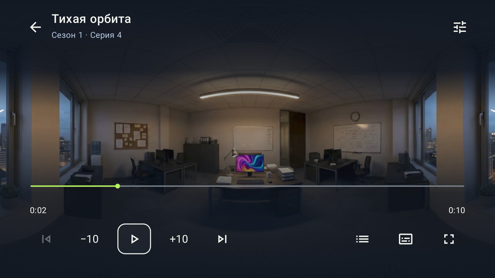
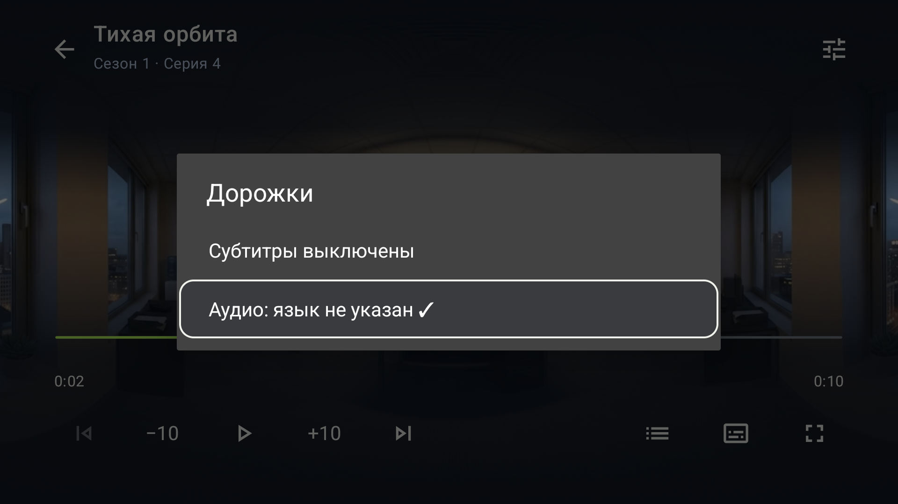
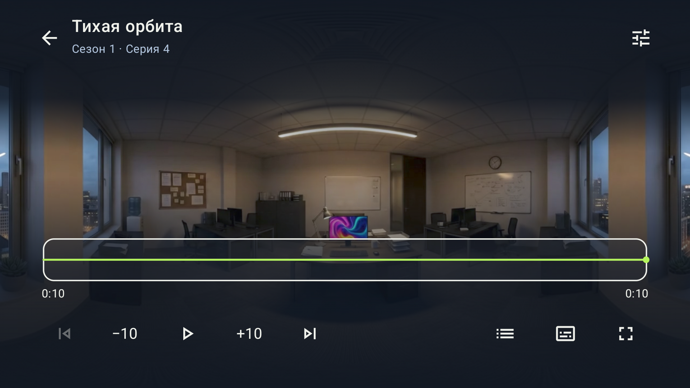
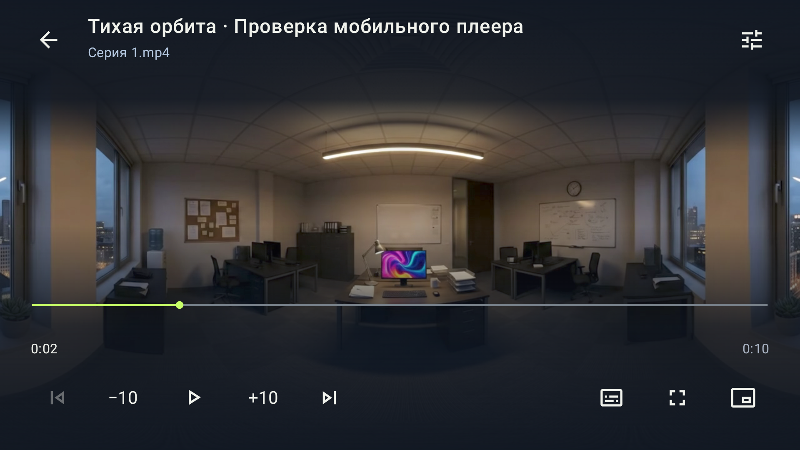

# Аудит плеера с пульта и мобильный дизайн — #39

18 ноября 2026. Продолжение выбранного дизайна из #32. Исходная версия: main `ff4081f` / 0.9.2. Изолированная ветка `codex/mobile-player-design`; чужие рабочие каталоги и расписания не изменялись.

## Что проверено и исправлено

| Шаг пользователя | Наблюдение / причина | Изменение |
| --- | --- | --- |
| Открыть серию, закрыть предложение следующей серии через Back | **P1, воспроизведено:** видимые кнопки без фокуса. [Исходный тест](before/remote-test.txt), [дерево: все Focused=false](before/no-focus.txt), [кадр](before/no-focus.png). Программного назначения фокуса в новом сценарии нет. | TV запрашивает режим ввода Keyboard. Возврат фокуса выполняется после удаления подсказки из композиции. |
| Пять раз открыть дорожки, выбирать аудио или закрывать через Back | **Риск по коду:** прежний запрос выполнялся при закрытии меню до возврата фокуса Android-окну; исходный сквозной тест останавливался на предыдущем P1, поэтому отдельное исходное падение этого шага не заявляется. | Учитываются `isWindowFocused` и закрытие модального окна; фокус возвращается на открывшую его кнопку, включая повторное открытие того же меню. |
| Открыть параметры видео, затем вложенную скорость и закрыть | Та же граница нативного окна; нужен возврат на «Параметры видео». | Сквозной D-pad сценарий проверяет этот путь и верхнюю кнопку дорожек отдельно. |
| Перейти вверх на шкалу и нажать Right | **P2:** линия была принудительно сдвинута вниз на 8 dp относительно рамки. | Убран сдвиг линии и встречный сдвиг времени; область шкалы 48 dp, линия и маркер по центру рамки. Preview сохраняется до OK, Back отменяет. |
| Подсказка скрывается из-за preview; появляется загрузка или ошибка | Конкурирующие запросы фокуса выявлены регрессионными тестами. | Основной плеер не перехватывает фокус подсказки. Скрытие подсказки во время preview не уводит фокус со шкалы. Карточка статуса получает фокус после готовности окна/кадра. |
| Смотреть на телефоне | **P2:** отдельная мобильная ветка сохранила старую залитую Play и прежнюю графику после TV-редизайна. | Мягкие градиенты, компактные светлые иконки, тонкая лаймовая линия, без постоянных подписей. Маркер рисуется вместе с линией, без смещения. |

## Реальные кадры после исправления

Это снимки установленного APK с реальным MP4 через Media3, а не макеты. Десятисекундный fixture и номера серий отличаются от иллюстрации в #32. Изображения не ретушировались.

## Контракт управления

D-pad Left/Right на скрытом плеере перематывает без показа панели; Up открывает верхнюю строку, Down — транспорт. OK переключает воспроизведение однократно. На шкале Left/Right меняет preview, OK подтверждает, Back отменяет, Up отменяет и скрывает, Down возвращает на Play. Back вне preview/подсказки/меню выходит одним нажатием. Модальное окно, preview и состояния загрузки удерживают панель.

Мобильный таймер, touch-scrub, двойной тап ±10, PiP, масштаб и переключение серий сохранены. Семантические описания доступны для accessibility; видимые подписи действий не добавлены. Touch-цели кнопок минимум 48 dp, Play 56 dp.

## Проверки и ограничения

Локальная среда: собственный Android API36 Google APIs arm64 эмулятор, установленный TV APK, настоящее видео, отдельный ADB-сервер. Для TV-прогона задана естественная горизонтальная геометрия 1920×1080: телефонная естественная портретная ориентация иначе сбрасывалась между тестами и давала обрезанные TV-кнопки. Это настройка стенда; производственная обработка ориентации не менялась.

Новый `remoteOnlyWalkthroughKeepsFocusAcrossTracksAndNestedVideoPanels` использует только реальные D-pad/OK/Back и наблюдает фокус. Старые низкоуровневые проверки могут назначать начальный фокус для проверки отдельного контракта; они не выдаются за сквозной путь пользователя.

Физический проектор, модель пульта, OEM-прошивка и пользовательский поток не проверены. У fixture одна аудиодорожка и нет встроенных субтитров: проверены выбор существующего аудио, отключение субтитров, навигация и возврат из панели; переключение между несколькими реальными языками не заявляется. Нативные меню сохраняют системное оформление.

Итоговые локальные логи находятся рядом с этим отчётом. Обязательные облачные build/mobile/TV runtime и публикация отслеживаются по PR и релизу; локальные тесты не подменяют их.

| Локальная проверка | Результат |
| --- | --- |
| Playback JVM | 12/12 |
| Core JVM | 65/65 |
| Remote contracts + mobile gestures | [16/16](remote-regressions-final.txt) |
| Установленный TV APK, реальное видео | [5/5](tv-final.txt) |
| Мобильный дизайн и порядок серий | [2/2](mobile-final.txt); [повторный touch-проход 1/1](mobile-touch.txt) |
| Шесть изменений размера окна, все кнопки и сохранённая пауза/позиция | [1/1](resize-final.txt) |
| Mobile + TV lint и debug/test APK | [успешно](final2-build.log) |
| Обе release-сборки и Core JVM | [успешно](release-build.log) |

Кандидат — **0.9.3**, базовый versionCode 1095; стабильный pipeline назначает опубликованным APK `1000 + run_number`. Signing, workflow и серверный контракт не изменены. Четырёхсторонняя облачная проверка не запускалась и не заявляется пройденной.
