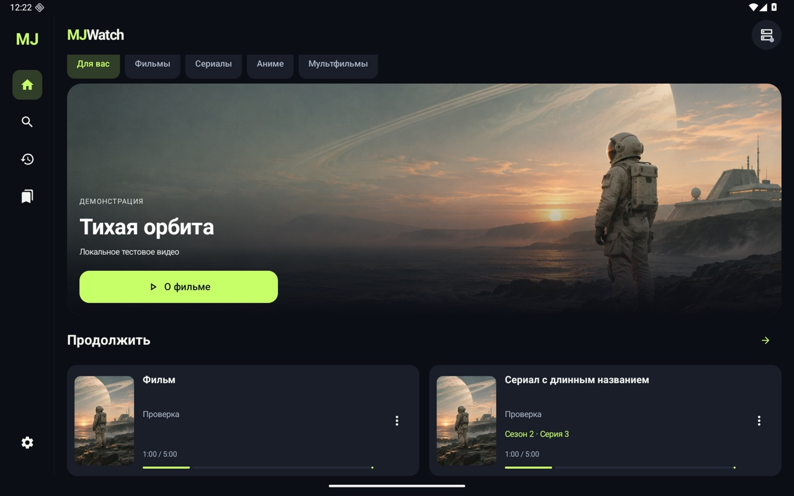
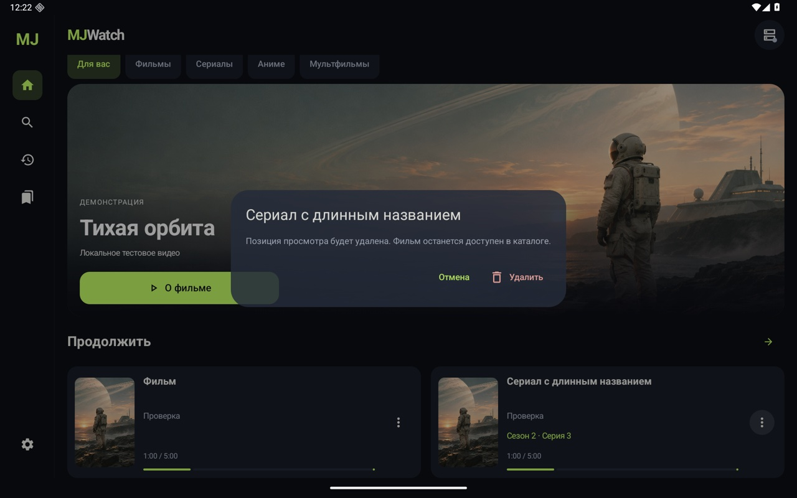

# Issue #45 — MJWatch 0.9.5

База: опубликованная 0.9.4, main `9edb42e6e2fbe3bd3c44811ca0814c5b50d856cd`. [Issue](https://github.com/MJSasha/mj-watch/issues/45).

- Цвет действия удаления задан у TextButton, поэтому и корзина, и подпись наследуют error из текущей темы.
- Постер больше не растягивается узкой полосой по высоте текста: рамка 96 × 144 dp (2:3). Настоящие постеры масштабируются целиком через Fit, демо-изображение кадрируется по персонажу. Высота карточек фильма и сериала остаётся одинаковой. Фоновые изображения сохраняют прежний Crop.

## Проверки

Обе debug-сборки и lintDebug прошли. На отдельном Google APIs эмуляторе API36: OpenIssuesUiTest — 2/2 на телефоне 1080×1920, density420; 2/2 на планшете 1920×1200, density240. Проверены одинаковая высота карточек, пропорции постера 2:3, модалка/отмена, переход к серверу и HTTP echo 200/503. Окончательный визуальный сценарий повторён напрямую на каждой конфигурации (1/1) для сохранения скриншотов. Нативный Android TV проверяет штатный CI.

Логи: [сборки](build.txt), [телефон](phone-runtime.txt), [планшет и финальный lint](tablet-runtime.txt), [финальный телефон](phone-evidence.txt), [финальный планшет](tablet-evidence.txt).

## Полный CI

В [PR-прогоне 115](https://github.com/MJSasha/mj-watch/actions/runs/44294540120) build и mobile прошли. Один неизменённый TV-тест `changingQualityAudioSpeedAndFitKeepsPausedPosition` получил timeout в финальной проверке выхода по Back (строка 178); проверки параметров и позиции до этого прошли. Остальные четыре сценария настоящего видео также прошли. TV job отдельно перезапущен для проверки нестабильности.

На точном коммите выпуска `2d1ae806efc72d49d09638483ae93b2ddaf64998` [main-прогон 116](https://github.com/MJSasha/mj-watch/actions/runs/44295282648) с первой попытки прошёл build и обе runtime-матрицы без изменения кода или утверждений теста. Mobile: 50 passed / 34 skipped / 0 failed; Android TV: 35 passed / 14 skipped / 0 failed; playback на Android TV: 20 passed / 0 skipped / 0 failed. Пропуски требуют внешних сервисов или специальных конфигураций и не засчитываются как пройденные. [Итог HTML-отчётов](ci-runtime-summary.json).

## Выпуск и проверка обновления

[**MJWatch 0.9.5 — test-116**](https://github.com/MJSasha/mj-watch/releases/tag/test-116), versionCode **1116**, Latest, не draft/prerelease. Все jobs main-прогона, включая публикацию, завершились успешно.

Скачанные APK проверены по размерам/SHA-256 из update.json, SHA256SUMS и GitHub asset digest, package/version и прежнему сертификату. APK не debuggable и не содержит debug MKV fixture. Хеши всех файлов серверной поставки 0.1.6 и подпись manifest проверены; открытый ключ совпадает с опубликованной 0.9.4. [Результаты](verification.json).

Обе опубликованные установки 0.9.4 (1113) обновлены через `adb install -r` до 0.9.5 (1116), без удаления. UID, приватный контрольный файл и SHA-256 config.preferences_pb сохранились у обеих платформ. [Проверка обновления](upgrade-verification.json). После обновления телефон и TV открыли сохранённый демо-каталог без FATAL EXCEPTION. [Проверка запуска](launch-verification.json).

Обновление и визуальные сценарии выполнены на отдельном Google APIs эмуляторе; полноценный Android TV runtime прошёл в CI. Физические OEM-устройства здесь не заявляются. Сервер остаётся 0.1.6: если он уже обновлён для 0.9.4, повторное обновление для этих UI-правок не требуется.
