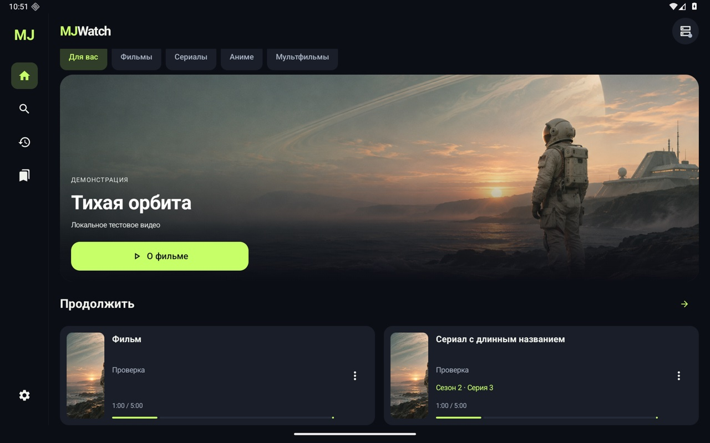
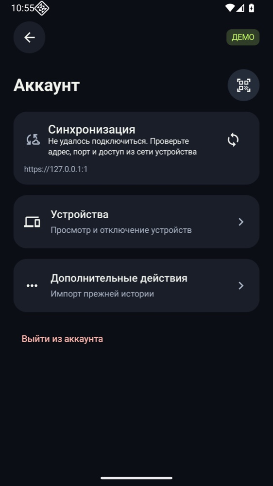
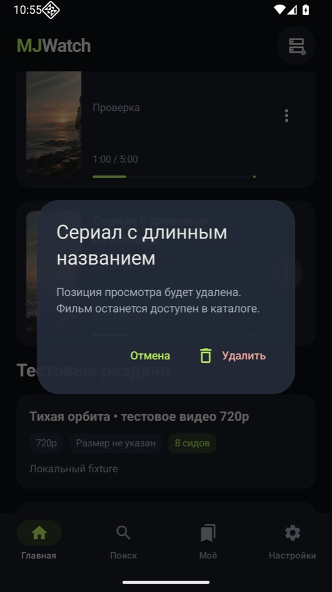
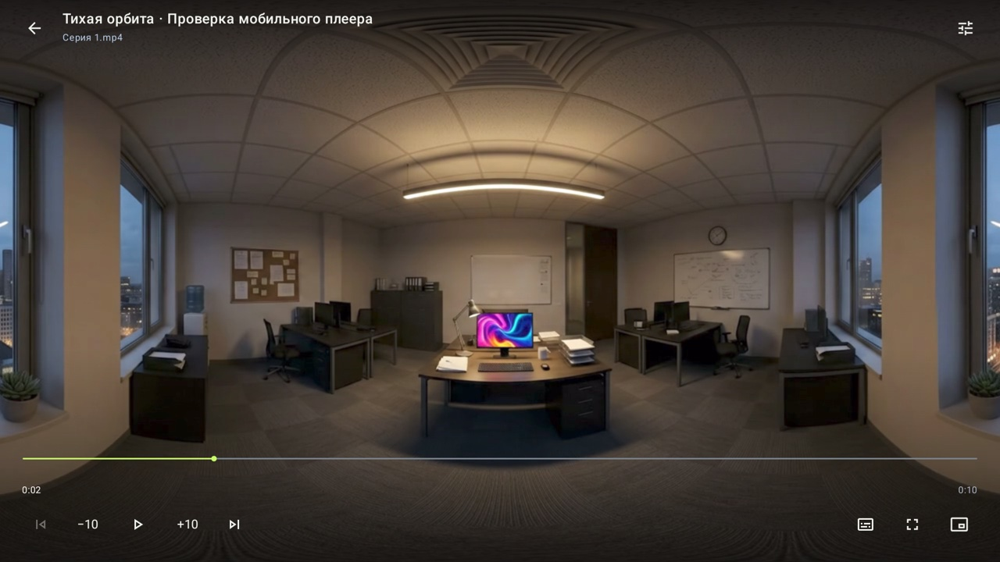
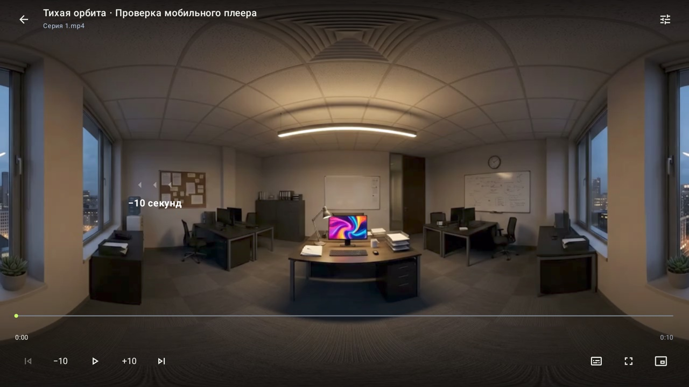

# Открытые issues → MJWatch 0.9.4

База: `1e7e8f9629e94eeca6ee31c6c69b305f6fdf83cd` (main / 0.9.3). Отдельная ветка `codex/open-issues-release`; исходная рабочая папка и её незакоммиченные материалы сохранены. Обработаны только открытые на старте #36, #37, #38, #41 и #42.

## Исправления

- **#36:** индивидуальный DELETE удаляет устройство и каскадно его сессии, профиль, remote receiver/receipts и привязку установки. Владелец и обычный пользователь могут удалить ранее отозванное устройство. Повторный вход объединяется по случайному UUID установки внутри одного аккаунта; одинаковая модель/название разных устройств не является основанием для объединения. Старые записи без UUID удаляются вручную. Поставка сервера — **0.1.6**; старый 0.1.5 продолжает работать с новым APK, поскольку дополнительное поле профиля отправляется только при объявленной сервером capability.
- **#37:** одинаковое место под заголовок и серию, постер по высоте текста; компактные действия истории; страница аккаунта с группой синхронизации; согласованные формы локальной и TV-кнопок; живой индикатор доступности с переходом в настройки сервера; меньшее и более прозрачное затемнение плеера. Устранён конфликт ключей секций истории и демо-раздач на главной.
- **#38:** Media3 получает явный Matroska MIME по исходному имени MKV, даже если managed URL не содержит расширения. Тест использует настоящий H.264/AAC MKV, а не переименованный MP4; проверяет первый кадр, аудио/видео, длительность и seek с мобильными и TV-контролами.
- **#41:** README с коротким описанием возможностей, видимыми скриншотами телефона, планшета, TV и плеера. В About репозитория добавлено описание через авторизованный Chrome; текст проверен после сохранения.
- **#42:** двойной тап сопровождается затухающей волной и тремя направленными стрелками с подписью на соответствующей половине видео. Не открывает скрытые контролы; прежние границы seek и запрет перемотки несекущегося потока сохранены.

## Проверки

| Проверка | Результат |
| --- | --- |
| Unit | 65 core + 12 playback, без ошибок и пропусков |
| Android gates | Обе lintDebug, debug и release сборки — [успех](android-gates.txt) |
| Телефон, API36 | 7 тестов: MKV, мобильный плеер, карточки/аккаунт/сервер, история, поиск, темы — [успех](phone-runtime.txt) |
| Финальный плеер/индикатор | 5 тестов: настоящий MKV в двух режимах, двойной тап с видео, карточки, HTTP echo 200/503 и переход — [успех](player-indicator-runtime.txt) |
| Планшет 1280×800 dp | Одинаковая высота карточек, модалка, аккаунт, переход — [успех](tablet-runtime.txt) |
| TV-оболочка 1280×720 dp | Модалка удаления с D-pad-фокусом, общие экраны и равная высота фильма/сериала — [3 passed](tv-shell-runtime.txt) |
| Мобильные жесты | Видимые/скрытые контролы, обе стороны, границы, non-seekable — [успех](gestures-runtime.txt) |
| Восстановление потока + индикатор | Раздельные /echo и видео-ответы, автоматический/ручной retry и HTTP 200/503 — [4 passed](recovery-indicator-runtime.txt) |
| Сессии при параллельных записях | Регрессия воспроизводит прежнюю гонку [3/3](refresh-before.txt); атомарный refresh и открытый поток [5 повторов успешны](refresh-stress-after.txt) |
| Сервер | [go test -race / vet](server-race-vet.txt), [install/TLS/packaging](server-full-check.txt) — успех |

Локальный runtime выполнен на отдельном эмуляторе API36 Google APIs, изолированном ADB-порту 5072, с локальными тестовыми данными и MockWebServer. TV-оболочка локально проверялась в широком окне этого эмулятора; полноценный Android TV runtime выполняет штатный CI перед публикацией. Серверные TLS-тесты запущены под Python 3.12/OpenSSL 3, как в CI: системный Python 3.9/macOS использует отличающуюся SSL-проверку. Локальная серверная поставка проверена с отдельным временным тестовым ключом; стабильные подписи APK и поставки выдаёт штатный publish job.

Физические TV/OEM, произвольные кодеки внутри MKV и новый полный четырёхдевайсный phone-to-TV прогон здесь не заявляются. Поддержка контейнера не добавляет отсутствующие аппаратные декодеры Android. Для полного удаления/дедубликации требуется обновить managed-сервер до 0.1.6.

## Визуальные результаты

Скриншоты настоящего APK, уменьшенные и сохранённые в JPEG для отчёта. Каталог/история демонстрационные, видео локальное.

| Аккаунт | История |
| --- | --- |
|  |  |

MKV fixture `playback/src/debug/assets/matroska-fixture` создан FFmpeg из `testsrc2=size=160x90:rate=12` и `sine=frequency=440:sample_rate=22050`, 12 секунд, libx264 CRF40 + AAC 32 kbit/s, контейнер Matroska. В release APK тестовый файл не включается.

## Полный CI

Первый [PR-прогон 108](https://github.com/MJSasha/mj-watch/actions/runs/44281454377) прошёл build и Android TV runtime. Два mobile-теста восстановления показали, что новый health probe `/echo` расходует очередь ответов, предназначенную для видео. Fixture теперь маршрутизирует echo отдельно; оба восстановления и индикатор повторно прошли локально (4 теста). Опрос живого индикатора ограничен STARTED lifecycle главного экрана. Новая TV-регрессия дополнительно проверяет равную высоту фильма и сериала. Полный повтор CI обязателен перед публикацией.

В [PR-прогоне 110](https://github.com/MJSasha/mj-watch/actions/runs/44284338290) серверный race-тест выявил SQLITE_BUSY_SNAPSHOT при обновлении токенов одновременно с завершением подготовки потока. Один условный UPDATE делает проверку и ротацию атомарными, сохраняя ограничения срока, отзыва устройства и блокировки пользователя. Старый refresh token после успешной ротации отклоняется. Конкурентная регрессия сначала провалилась в трёх запусках, затем прошла вместе с живым потоком пять раз; полный race/vet также зелёный.

В [PR-прогоне 112](https://github.com/MJSasha/mj-watch/actions/runs/44285697568) build и mobile прошли; один существующий TV-тест восстановления фокуса после диалога получил timeout. Повтор TV job прошёл без изменения утверждений или production TV-контролов. PR #44 слит коммитом `4c0190011c766196ed64a1b8c0cea990ae6d6912`.

Релизный [main-прогон 113](https://github.com/MJSasha/mj-watch/actions/runs/44289311229) прошёл build, сервер и обе runtime-матрицы с первой попытки. Из HTML-отчётов: mobile — 50 passed / 34 skipped / 0 failed; Android TV — 35 passed / 14 skipped / 0 failed; playback на Android TV — 20 passed / 0 skipped / 0 failed. Пропуски — проверки с внешними сервисами и специальными конфигурациями; они не засчитываются как пройденные. [Машиночитаемый итог](ci-runtime-summary.json).

## Опубликованный релиз и обновление

[**MJWatch 0.9.4 — test-113**](https://github.com/MJSasha/mj-watch/releases/tag/test-113), versionCode **1113**, Latest, не draft/prerelease. Все четыре job main-прогона, включая публикацию, завершились успешно. Исходный коммит релиза — `4c0190011c766196ed64a1b8c0cea990ae6d6912`.

Проверены скачанные из релиза APK и `mjwatch-0.1.6-supply.zip`: размер/SHA-256 из update.json, SHA256SUMS и GitHub asset digest; package/version обоих APK; прежний сертификат APK; подпись каждого серверного manifest и хеши всех вложенных файлов. Открытый ключ серверной поставки совпадает с опубликованной 0.9.3. APK не debuggable, MKV fixture не включён. [Результаты](verification.json).

На отдельном Google APIs эмуляторе обе опубликованные 0.9.3 (1106) настроены в демо-режиме, затем обновлены скачанными APK через `adb install -r` до 0.9.4 (1113), без удаления. У обеих установок сохранились UID, приватный контрольный файл и SHA-256 config.preferences_pb. [Проверка обновления](upgrade-verification.json). После обновления обе платформы открыли сохранённый демо-каталог, процесс работал без FATAL EXCEPTION; [проверка запуска](launch-verification.json). Это проверка обновления и запуска на эмуляторе, не замена проверки физических TV/OEM.

Для удаления и дедубликации устройств установить сервер **0.1.6**: Настройки → Мой сервер → Обслуживание → Обновить сервер. APK сохраняет совместимость с сервером 0.1.5.
