# Аудит настроек и управления пользователями MJWatch

16 ноября 2026. Дизайн-документ для реализации. Проверено работающее Android-приложение 0.5.5, локальный debug APK, телефонный эмулятор API 36, 1080×2340 px при 420 dpi (примерно 411×891 dp), тёмная тема. Захват: ADB screencap и UI Automator; каждый приведённый PNG открыт и проверен. Сервер — отдельный Go HTTPS/SQLite fixture, пользователи owner и Anna тестовые. Рабочие серверы и реальные аккаунты не затрагивались. Исходники при начале проверки: `47241a2`; соответствие установленного APK этому commit отдельно не устанавливалось.

Главный вывод: настройки воспроизведения имеют понятную структуру, но управление пользователями смешивает список, форму, приглашение и устройства на одной странице. Смена ответа сервера уничтожает видимый контекст задачи. Сначала нужно исправить сохранение состояния и обратную связь, затем заменить огромные карточки компактным списком и отдельной страницей пользователя.

## Цель и границы

Владелец должен найти нужного человека, пригласить его, проверить устройства и безопасно ограничить доступ. Проверены вход в настройки, обзор сервера, список, блокировка единственного владельца, создание пользователя, копирование приглашения, обновление списка, пустые устройства, аккаунт, предпочтения, выбор субтитров и начальный экран обновлений.

Не проверены вход получателя по приглашению, реальная доставка приглашения, заполненные устройства обычного пользователя, успешная блокировка/удаление, сбои сети, SSH, импорт/экспорт, каталог, direct-настройки, загрузка APK, планшет и TV. Поэтому это углублённый аудит управления пользователями и обзор части настроек, а не приёмка всех настроек.

## Шаги и скриншоты

| Шаг | Действие и состояние | Оценка | Наблюдение |
| --- | --- | --- | --- |
| 01 | Открыть настройки | Хорошо, есть улучшения | Видны текущие значения; аккаунт и сервер спрятаны внутри группы подключений |
| 02 | Управление сервером | Приемлемо | Есть здоровье сервисов; подпись «Открыть» повторяется, число пользователей отсутствует |
| 03 | Пользователи | Плохо | Один человек занимает почти весь экран; шесть действий; роли на английском |
| 04 | Блокировать владельца | Плохо | Доступно заведомо запрещённое действие; диалог не называет блокировку |
| 05 | Получить отказ | Плохо | Защита сервера работает; объяснение обнаруживается внизу после прокрутки |
| 06 | Создать Anna | Плохо | Приглашение получено, но список исчез, имя получателя не показано |
| 07 | Скопировать приглашение | Приемлемо | Кнопка подтверждает копирование; принадлежность приглашения всё ещё неясна |
| 08 | Обновить список | Плохо | Список вернулся; приглашение исчезло; уже два человека требуют длинной прокрутки |
| 09 | Открыть устройства Anna | Плохо | Список снова исчез; нет имени Anna, объяснения пустого состояния и локального возврата |
| 10 | Аккаунт и синхронизация | Требует изменений | Устройства, код TV, импорт и два вида выхода перемешаны; статус продублирован |
| 11 | Остальные группы настроек | Хорошо | Последовательные строки с текущими значениями и ясными группами |
| 12 | Выбрать субтитры | Хорошо, есть риск доступности | Текущее значение выделено цветом; нужен дополнительный маркер выбора |
| 13 | Выбрать русский | Хорошо | Диалог закрывается, значение сразу видно в строке; воспроизведение с этой настройкой не проверялось |
| 14 | Открыть обновления | Хорошо | Установленная версия, отдельная автопроверка и основное действие понятны |

### 01 Настройки

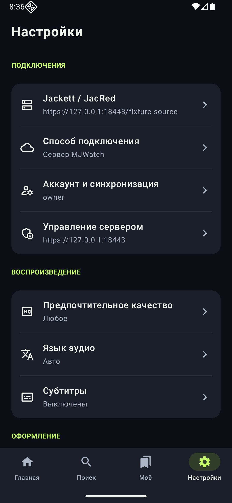

Сохранить группировку, полноширинные строки и вторичные значения. Отделить «Аккаунт» и «Мой сервер» от источников контента. Длинный адрес оставлять вторичной информацией с возможностью просмотра целиком.

### 02 Мой сервер

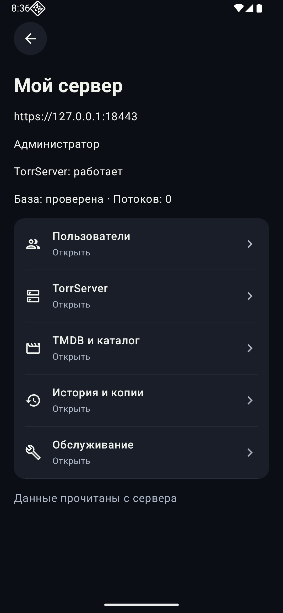

Сохранить фактические статусы. Заменить «Открыть» полезными сводками: «2 пользователя», «Ключ не настроен», если эти данные действительно загружены. Не подставлять вымышленные успешные статусы при ошибке.

### 03 Список пользователей

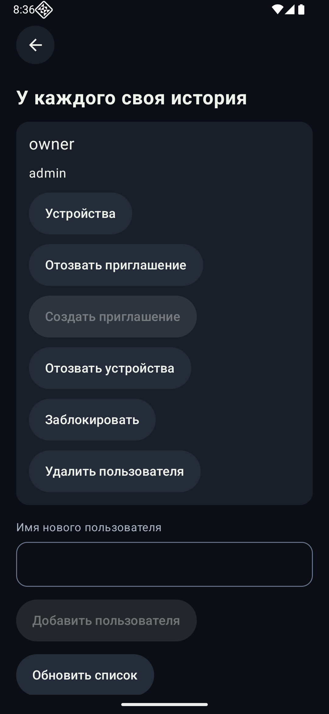

F01, F04: карточка owner содержит устройства, отзыв приглашения, создание приглашения, отзыв всех устройств, блокировку и удаление. Нет различия между обычными и разрушительными действиями. «Добавить» расположено после списка. Заголовок «У каждого своя история» не называет раздел.

### 04 Подтверждение блокировки

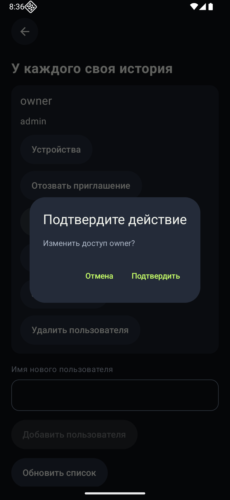

F03: «Подтвердите действие / Изменить доступ owner?» не объясняет результат. Для единственного владельца блокировку нельзя предлагать как выполнимую операцию.

### 05 Отказ сервера

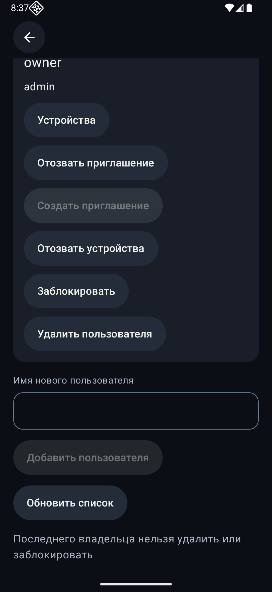

F03, F05: сервер сохранил владельцу доступ, но причина отказа появляется под формой и кнопкой обновления. Позднее при заполнении имени вместо неё наблюдалось «Синхронизировано»; общий канал сообщений перезаписывается фоновой синхронизацией. Это поведенческое наблюдение текущего прогона, а не свойство, доказанное одним статичным PNG.

### 06 Создание и приглашение

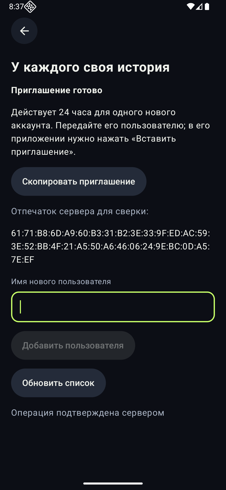

F02, F06: после создания Anna исчезают все карточки. Приглашение не подписано именем; форма создания остаётся рядом с ним. Полный отпечаток сертификата занимает три строки без пояснения процедуры сверки.

### 07 Копирование

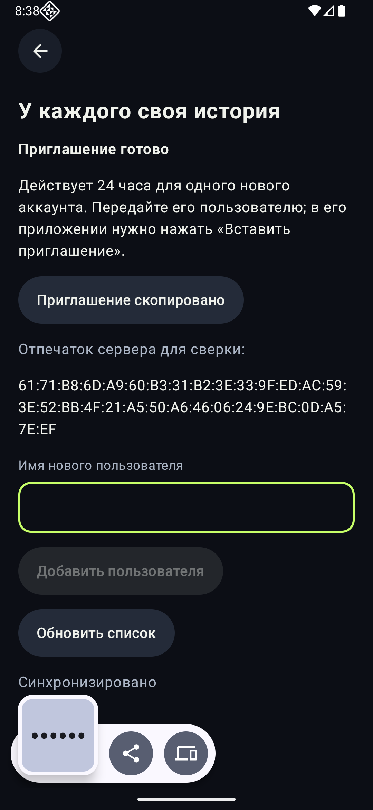

Сохранить явную смену подписи кнопки и защиту содержимого системного буфера: Android показывает замаскированный preview. Это не подтверждает безопасность пересылки или работы всех системных версий. Фоновое «Синхронизировано» внизу не относится к копированию приглашения.

### 08 Список после обновления

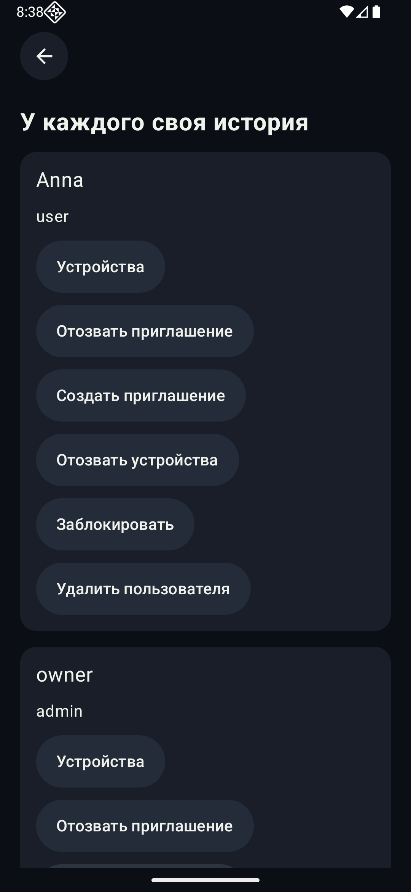

F01, F02: Anna присутствует, но рядом нет состояния приглашения. Тот же экран после другого ответа API потерял приглашение. Повторная выдача приглашения должна быть осознанным действием, поскольку сервер заменяет прежний токен.

### 09 Устройства Anna

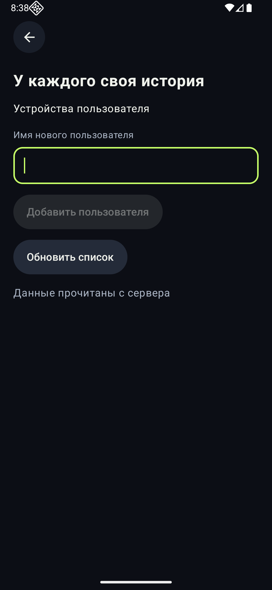

F02, F07: вместо списка показано «Устройства пользователя» без имени и без «Устройств пока нет». Ниже осталась нерелевантная форма нового пользователя. «Обновить список» возвращает пользователей, а не обновляет устройства. В исходниках это всё одна страница `server-users`, поэтому Back ведёт в обзор сервера.

### 10 Аккаунт

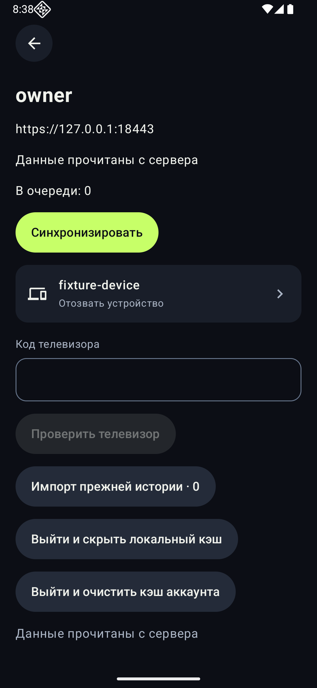

F08: дублируется «Данные прочитаны с сервера»; импорт с нулём записей выглядит доступным; код TV сразу открыт, хотя это отдельная задача; два вида выхода требуют понимания технического слова «кэш». Не показано, является ли fixture-device текущим устройством; это не устанавливалось в прогоне.

### 11 Группы настроек

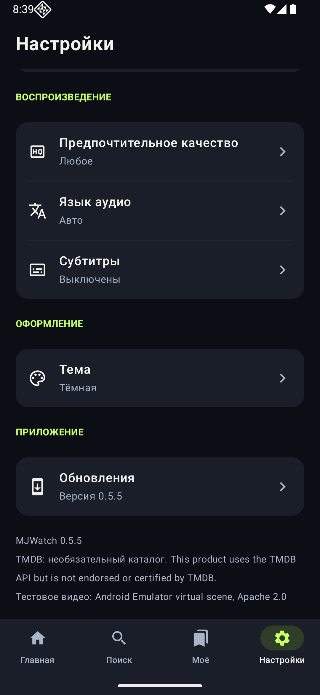

Сохранить модель «название + значение + переход». Длинный технический/legal текст лучше вынести в «О приложении», не меняя обязательные атрибуции.

### 12 Диалог субтитров

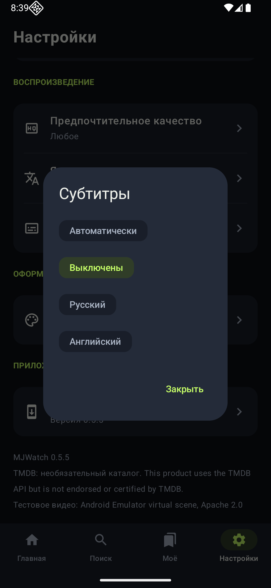

Выбор выделен цветом фона и текста. Добавить radio-маркер и доступное состояние «Выбрано»; наличие корректного объявления TalkBack визуально не подтверждается.

### 13 Результат выбора

Сразу после выбора строка показывает «Русский». Это хороший образец локальной обратной связи для остальных настроек.

### 14 Обновления

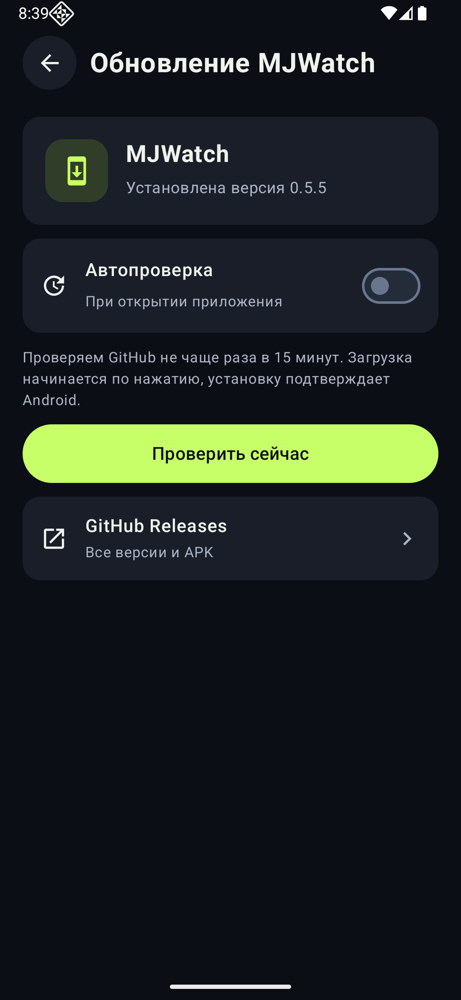

Сохранить объяснение различий проверки, загрузки и установки. Здесь проверен только исходный экран, без сетевой проверки и установки.

## Замечания и приоритеты

P1 — исправить до расширения управления пользователями: мешает завершению задачи или пониманию доступа. P2 — следующий проход: повышает ясность и снижает нагрузку. Подтверждённой потери данных или обхода прав в этом аудите нет.

| ID | Приоритет | Доказательство | Правка | Критерий приёмки |
| --- | --- | --- | --- | --- |
| F01 | P1 | 03, 08 | Компактный список, создание над списком, отдельная карточка человека | Добавление доступно без прокрутки; действия не повторяются по шесть раз для каждого человека |
| F02 | P1 | 06, 08, 09 | Разделить состояние списка, выбранного пользователя, устройств и приглашения | Ни один ответ API не заменяет данные другого раздела; возврат сохраняет позицию списка |
| F03 | P1 | 03–05 | Запретить блокировку/удаление последнего владельца в UI с объяснением; оставить серверную защиту | Недоступное действие объяснено до отправки; гонка прав корректно обрабатывается по ответу сервера |
| F04 | P1 | 03, 04, 08 | Отделить опасные действия и конкретизировать подтверждения | Заголовок содержит действие и имя; текст содержит последствия; кнопка названа действием |
| F05 | P1 | 05, 07 и наблюдение фоновой синхронизации | Независимые сообщения операции и синхронизации; ошибка возле действия | Ошибка не исчезает из-за фоновой синхронизации, доступна без прокрутки и объявляется ассистивным средствам |
| F06 | P1 | 06–08 | Приглашение подписать именем, сроком и последствиями перевыпуска | Понятно, кому предназначено приглашение; нельзя незаметно заменить действующее |
| F07 | P1 | 09 | Отдельный экран устройств с именем и честным пустым состоянием | «Устройства Anna / Устройств пока нет»; Back возвращает к Anna; обновление обновляет устройства |
| F08 | P2 | 10 | Разделить аккаунт, устройства, подключение TV и выход | Импорт при 0 записей недоступен с пояснением; выход имеет понятную политику локальных данных |
| F09 | P2 | 02, 03, 08 | Русские роли, однозначные заголовки, полезные сводки | «Пользователи», «Администратор», «Пользователь», «Это вы» вместо слогана и raw role |
| F10 | P2 | 12 | Дополнить цветовой выбор radio-маркером и семантикой | Выбранный пункт распознаётся без цвета, объявляется состоянием выбора |

## Предлагаемая структура экранов

Использовать существующие цвета и компоненты: фон `#0C0E15`, поверхности `#191E29` и `#242B39`, текст `#F0F2EC`, вторичный текст `#ABB5C5`, основной лаймовый `#C7FF68`. Опасные действия использовать с семантическим error-цветом темы и явным текстом. Не вводить новую визуальную систему.

| Экран | Содержимое сверху вниз | Основное действие |
| --- | --- | --- |
| Настройки | Подключения; Аккаунт; Мой сервер для администратора; Воспроизведение; Оформление; Приложение | Переход в выбранный раздел |
| Пользователи | Заголовок и число; кнопка добавления; компактные строки имени, роли и известного состояния | Добавить пользователя |
| Пользователь Anna | Имя; роль; доступ; приглашение; устройства; отдельный блок ограничения доступа | Открыть приглашение или устройства |
| Новый пользователь | Поле имени; объяснение личной истории; ошибка поля | Создать и получить приглашение |
| Приглашение для Anna | Имя; одноразовость; оставшийся срок; инструкция получателю; копирование; раскрываемая проверка сервера | Скопировать приглашение |
| Устройства Anna | Имя человека; список устройств или пустое состояние; последняя активность; отзыв конкретного устройства | Отключить выбранное устройство |

На телефоне использовать отдельные страницы и стандартный Back, на планшете/TV — список и детали рядом при достаточной ширине. Эти адаптации — требования следующей проверки, а не проверенные макеты. Список строить лениво; не добавлять поиск и фильтры без необходимости. Строка пользователя имеет минимум 72 dp, тач-цель минимум 48×48 dp, отступы экрана 20 dp и внутри групп 16 dp. Текст допускает перенос и увеличение размера; фиксированная высота не должна обрезать имя.

## Примеры содержания и поведения после правок

Это примеры спецификации, а не скриншоты реализованного редизайна. Вымышленные состояния не следует переносить в UI без данных сервера.

### Список и создание

Заголовок: **Пользователи · 2**. Основная кнопка: **Добавить пользователя**. Строки: **owner — Администратор · Это вы**, **Anna — Пользователь**. Состояние «Приглашение ожидает принятия» показывать только после расширения API, когда оно достоверно известно.

Создание: поле **Имя пользователя**, подсказка **У каждого пользователя будут отдельные история и избранное**, кнопка **Создать и получить приглашение**. Во время запроса — **Создаём пользователя…**, повторная отправка заблокирована. При ошибке имя остаётся. Для занятого имени: **Это имя уже используется. Выберите другое**. Нормализацию имени и ограничения длины согласовать с сервером; текущая серверная проверка длины использует байты, а не число видимых символов.

После успеха автоматически обновить список, выбрать созданного человека и открыть **Приглашение для Anna**. Не оставлять пустую форму создания на странице результата.

### Приглашение

Заголовок **Приглашение для Anna**. Текст **Одноразовое. Действует 24 часа с момента создания**; после получения серверного срока показывать точное локализованное время окончания. Инструкция: **Отправьте приглашение Anna. На её устройстве: Настройки → Способ подключения → Войти на сервер MJWatch → Вставить приглашение**. Кнопка **Скопировать приглашение**, подтверждение **Приглашение для Anna скопировано**.

Проверка сервера — раскрываемый блок с адресом, полным отпечатком и пояснением **Получатель сверяет этот отпечаток с вами по доверенному каналу**. Не убирать саму проверку доверия. При повторном создании: **Создать новое приглашение для Anna? Прежнее приглашение перестанет работать**; кнопка **Создать новое**. После ухода не пытаться восстановить секрет из хеша на сервере: показать сведения о приглашении и осознанный перевыпуск.

### Устройства и опасные действия

Пустое состояние: **Устройства Anna / Устройств пока нет / Устройства появятся после первого входа**. Без формы нового пользователя. Заполненная строка: имя устройства, локализованная активность, состояние доступа; «Это устройство» только при надёжном сопоставлении ID.

Блокировка: **Заблокировать Anna? / Anna не сможет входить на сервер. Доступ её устройств будет отозван. История сохранится. После разблокировки понадобится повторный вход.** Кнопки **Отмена** и **Заблокировать**. Сервер уже отзывает устройства при блокировке; разблокировка не должна обещать восстановление старых сессий.

Удаление: **Удалить Anna? / Будут удалены аккаунт и его история, доступ устройств будет отозван. Сохранённые на устройствах офлайн-данные удалённо не стираются. Отменить удаление нельзя.** Кнопки **Отмена** и **Удалить Anna**. Не обещать undo без соответствующей серверной возможности.

Последний владелец: недоступные блокировка и удаление с постоянным объяснением **Это последний администратор сервера. Его нельзя заблокировать или удалить**. Не предлагать назначение нового администратора, пока такой сценарий реально не поддерживается.

### Аккаунт

В верхней группе: имя, сервер и состояние **Синхронизировано** либо **Есть изменения на устройстве**. Затем переходы **Мои устройства** и **Добавить телевизор**. Импорт перенести в дополнительные действия; при нуле — **Нет прежней истории для импорта**. Выход оформить одним входом в диалог с понятным выбором сохранения или удаления данных на этом устройстве и объяснением судьбы неотправленных изменений.

## Состояние и API для реализации

Подтверждение исходниками: `ServerScreens.kt`, ветка `server-users`, читает `users`, `devices` и `invite` из одного `managed.data`; `ManagedController.load/action` заменяют `data` каждым ответом. Это объясняет исчезновение списка. Там же один `message` используют административные операции и фоновая `sync`. `WatchModel.back` для `server-*` возвращает обзор, без отдельного маршрута устройств.

Минимальная правка: хранить отдельно список пользователей, выбранный ID, устройства выбранного ID, результат создания приглашения и сообщение конкретной операции; добавить явный возврат из деталей. Не требуется глобальная архитектурная переработка. Результат загрузки связывать с сервером, аккаунтом и выбранным человеком, чтобы запоздалый ответ не показывал чужой контекст.

Текущий `GET admin/users` возвращает только `id/name/role/blocked`; `POST admin/users` и выдача приглашения возвращают `userId/invite/expiresIn`; список устройств — отдельный запрос. Для честного списка со статусами нужны дополнительные сведения: состояние и срок приглашения без самого токена, число устройств и причина запрета административного действия. Это проектируемое расширение, а не уже существующие поля. Без расширения показывать только известные имя, роль и блокировку; детали загружать по запросу.

## Доступность и ограничения доказательств

Подтверждённые сильные стороны: крупные видимые элементы, подпись Back в UI Automator, текстовое подтверждение копирования, видимые текущие значения. В исходниках у общего сообщения есть polite live-region; его реальное объявление TalkBack не проверялось.

Риски: повторяющиеся «Устройства» и «Удалить пользователя» без имени в доступной подписи; длинная последовательность из шести кнопок на каждого человека; выбор субтитров визуально опирается на цвет; ошибки находятся вне видимой области. Задать именные доступные названия, логичный порядок чтения, семантические заголовки, radio-состояния и фокус на результате/ошибке. После закрытия диалога возвращать фокус к вызвавшему действию, после удаления — к следующему пользователю.

Скриншоты не подтверждают соответствие WCAG, точный контраст всех состояний, работу TalkBack, Switch Access, внешней клавиатуры и D-pad. Отдельно нужны fontScale 2.0, узкий экран, длинные кириллические имена, светлая тема, потеря сети, восстановление после поворота и системного уничтожения процесса. Для TV не уменьшать hit/focus-цели ради компактности списка.

## Очерёдность и проверка результата

1. Исправить F02/F05: независимые данные, сообщения операций и синхронизации, сохранение имени при ошибке создания.
2. Исправить F03/F04: запреты владельца и конкретные подтверждения с последствиями.
3. Реализовать F01/F06/F07: список, отдельный пользователь, приглашение и устройства, правильный Back.
4. Реализовать F08–F10 и проверить адаптацию/доступность.

Приёмочные сценарии: создание Anna не скрывает остальных; копирование явно относится к Anna; отказ из-за занятого имени сохраняет ввод; фоновая синхронизация не стирает отказ операции; пустые устройства имеют имя и объяснение; Back восстанавливает контекст; повторное приглашение предупреждает об отзыве предыдущего; последний владелец защищён и в UI, и на сервере; блокировка не обещает удаление истории; выбор настройки виден после возврата.

В текущем прогоне существующий `ManagedServerTest` завершился `OK (1 test)` на изолированном fixture. Это дополнительная проверка работоспособности тестового окружения, а не доказательство исправления UX. Изменения приложения этим документом не вносятся.
